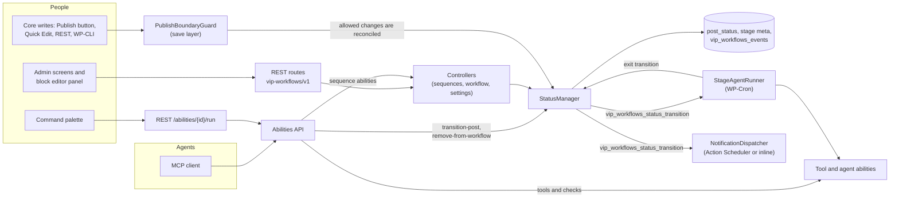
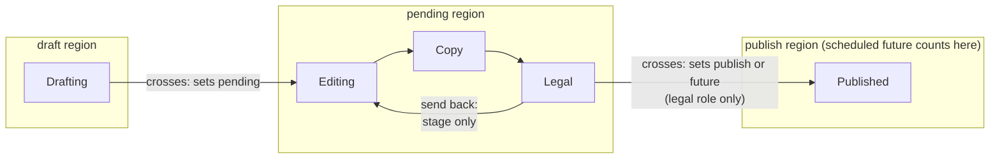
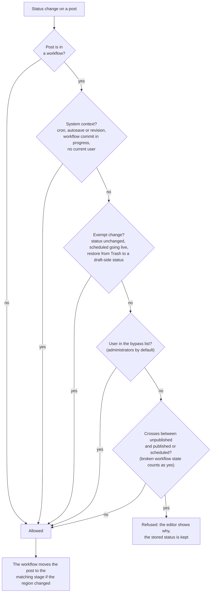
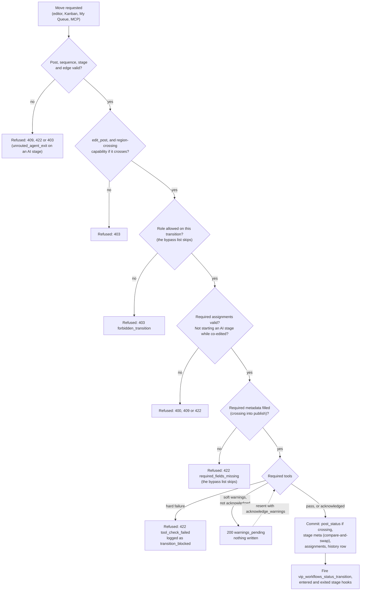
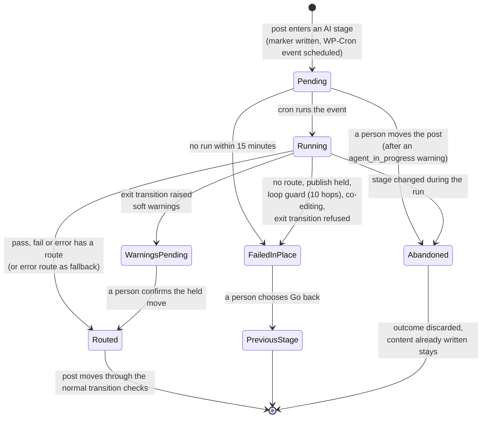
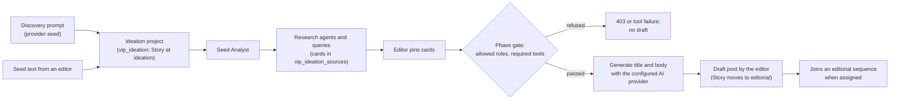

# VIP Workflows specification

VIP Workflows lets an editorial team model its process as a sequence of stages in WordPress, then enforces that process where people already work: the block editor, the admin, the command palette and MCP. Any stage can be owned by a person or by an AI agent. Transitions between stages carry the team's rules: who may move the post, which checks must pass, and who hears about it.

Two promises hold across the product:

- **Abilities first.** Anything a person can do in wp-admin, an agent can do too. Every operation is a WordPress Ability, reachable from the admin UI, the command palette, REST and MCP, with the same permission checks on every path.
- **Transparent.** People can see what happened and why. Every AI step is a tool, agent or assistant that an admin can see and tune, using the site's own provider keys. Every move, refusal and configuration change, by a person, an agent or MCP, is recorded in the post's history and the Audit Log.

## How to use this document

This is the one spec for the plugin and its extensions in this repo. It describes what the code does on `main` today. Where it and the code disagree, the code is true, and the spec needs updating.

- **Reviewing a PR:** read the stories the PR touches, then check the change against the [platform surface](#platform-surface) and the feature's **Always true** list. Each feature section lists its own footguns.
- **Writing a PR:** update the parts of this file your change affects, in the same PR, and name them under **Spec changes** in the PR description. A change to behavior, stored data, routes, permissions, background jobs, outbound calls or extension points always needs an update here. A PR that changes none of them says why and carries the `no-spec-change` label; so does a fix for a bug this file never mentioned, since the spec already describes the intended behavior. See `AGENTS.md` for the full rule and the Spec check.
- File paths are relative to the repo root.

Contents: [Glossary](#glossary) · [User stories](#user-stories) · [Platform surface](#platform-surface) · [Features](#features) · [Proposed](#proposed)

## Glossary

- **Sequence.** An admin-defined process stored as one row in `{prefix}vip_sequences`: either a `workflow` (a graph of stages and transitions) or a `phase` (the Ideation → Editorial lifecycle). A post follows a sequence only after it is explicitly assigned to one, and each site's sequences are independent of every other site's.
- **Stage.** One step in a workflow sequence, such as Editing or Legal, with a key, a label and a status region. A post's current stage is stored in `_vip_workflows_current_stage_key`; it is not a WordPress post status, and it does not lock editing.
- **Status region (region).** The core post status a stage belongs to: `draft`, `pending`, `private` or `publish`. Several stages can share a region, and `post_status` only changes when a post moves to a stage in a different region. Scheduled `future` counts as the publish side.
- **Transition.** A move a sequence allows from one stage to another, defined on the source stage with its role limits, required tools, inputs and notifications. Every transition, from every surface, runs through `StatusManager::transition()`.
- **Crossing.** A transition whose two stages sit in different regions. It is the only kind of move that writes `post_status`, and crossing into or out of the publish side is guarded by the publish boundary.
- **Reseat.** What the workflow does when something outside it, such as the Publish button, Quick Edit, REST, WP-CLI, cron or untrash, changes a post's status: it moves the post to the region entry stage of the new region and records the change with `cause: 'core'`. The overlay statuses `future` and `trash` never reseat.
- **Region entry stage.** The one stage per used region marked `region_entry`. It is where a reseat lands a post and where a post is seated when it is first assigned to a sequence.
- **Bypass list.** The `bypass_workflow_roles` setting (default `administrator`). Members see every transition, skip transition role limits and required metadata, and are not stopped by the publish boundary, but still need core capabilities. The separate **tool-check bypass list**, `bypass_tool_check_roles` (default `administrator`), only lets members skip required tool checks on a transition.
- **Stage agent.** An ability set on a stage through the stage's `agent` config, which makes that stage AI-owned. When a post enters the stage, the agent runs in the background on WP-Cron as the post's author, returns `pass` or `fail`, and the sequence's routes decide where the post goes next.
- **Tool.** An ability that a transition can require or that people run from the command palette or MCP. Its `meta.type` (`check`, `validator` or `helper`) only groups it on the Tools page: checks such as `seo-check` report issues that can block a move, and helpers such as `smart-linking` and `headline-suggestions` make suggestions. On a transition, every required tool is judged by the issues it returns, whatever its type.
- **Ability.** A unit of work registered through the WordPress Abilities API. Every Workflows operation is one, so the admin UI, command palette, REST and MCP all reach it with the same permission checks; extensions add their own with `vip_workflows_register_ability()`.
- **Experiment.** An unfinished feature (`ideation`, `kanban`, `calendar`, `my_queue`) that is off by default and switched on per site. Turning one off removes its UI and stops its background work without deleting data.

## User stories

Workflows does nothing to a post until an admin creates a sequence for its post type and the post joins it. From then on, the stories below describe what people do with it. They are grouped by who turns it on. A PR that breaks one of them is a regression even if every test passes.

Each story ends with what is always true while the story holds.

### Newsroom

**N1. An editorial team puts its whole process inside WordPress.** A publisher with writers, editors, copy chiefs, SEO and legal review runs that process partly in other tools today, with the CMS as one stop among several. An admin builds a sequence with one stage per step (Drafting, Editing, Copy, Legal, Ready), and each stage sits in the WordPress status region it belongs to. Several review stages can all be `pending` to WordPress. Writers and editors then work only in the block editor: the workflow panel shows the current stage and the moves available from it.
*Always true:* a stage's region decides the post status. Moving between stages in the same region never changes `post_status`. → [Sequences and stages](#sequences-and-stages)

**N2. An editor can't publish around the process.** A post in a sequence can't cross into or out of the publish side (`publish`, and scheduled `future`) except through a transition that leads there. The rule holds whether the editor uses the block editor's Publish button, Quick Edit, Bulk Edit, REST, or WP-CLI run as a user. In the block editor they see an error explaining why. Removing a post from its sequence is the audited way out. Roles in the bypass list (administrators by default) are exempt.
*Always true:* the save-layer guard covers every write path a person can use. A new write path is a footgun until it is covered. → [Publish boundary](#publish-boundary)

**N3. A transition enforces the desk's rules.** Moving a story from Editing to Ready runs the tools the transition requires: an SEO check, a checklist, a Parse.ly performance check. Hard failures stop the move, and soft warnings must be acknowledged before it goes through. Transitions can be limited to roles and can notify email or Slack when they fire.
*Always true:* every move, from every surface (editor, Kanban drag, My Queue, MCP), goes through `StatusManager::transition()`, and its checks run on the server. A tool's configurable settings must also be declared in its input schema, or every run is rejected. → [Transitions and tools](#transitions-and-tools)

**N4. An AI agent owns a stage, and the sequence decides where the post goes next.** A commerce desk sets an AI agent on its "Affiliate Linking" stage. When a post arrives, the agent runs in the background as the post's author, inserts the links it can verify, and leaves a note on anything ambiguous (two catalog matches for one product) instead of guessing. It then returns pass or fail, and the routes the sequence author set send the post on. Fail can send it to a human review stage.
*Always true:* an agent returns only `pass` or `fail`, and anything else is treated as an error. An agent's content changes are saved as its own attributed revision. An agent can't publish or make a post private unless the sequence allows agent publishing and the post's author holds `publish_posts`. Agent-to-agent hops stop after 10 in a row. → [Stage agents](#stage-agents)

**N5. A person and an agent don't overwrite each other.** A person can't start an AI stage while others are co-editing the post. An agent's write is abandoned if the post changed after the agent read it, and the editor asks before saving over an agent's newer write.
*Always true:* an agent never silently replaces a newer human save. → [Stage agents](#stage-agents)

**N6. Each desk or brand runs its own process on one install.** A publisher with many mastheads, or one site with a commerce desk and a news desk, keeps a separate sequence for each, limited to its own post types. Desks change their own stages without filing an engineering ticket. A sequence can be exported from one site and imported into another, but the import is an independent copy: Workflows doesn't share or sync sequences across a network, and isn't designed to.
*Always true:* sequences don't share state. A change to one sequence never moves or reroutes posts in another. → [Sequences and stages](#sequences-and-stages)

**N7. An editor knows what's theirs.** My Dashboard lists the posts someone wrote recently, claimed, or has been assigned. A transition can hand the post to a named person or a role. With the My Queue experiment on, the dashboard also lists posts the person can move forward next, with one-click quick actions.
*Always true:* these lists respect read permissions. A person never sees a post they can't read. → [Assignments](#assignments), [Experiments](#experiments)

**N8. Someone can always answer "who moved this, and why?"** The post's history shows each stage change and who or what made it, with stage labels as they were at the time. The site-wide Audit Log records stage changes, blocked transitions, tool runs and warnings, assignments and claims.
*Always true:* every committed stage change, by a person, an agent or MCP, writes exactly one history entry. A path that changes stage without one is a bug. → [Audit and history](#audit-and-history)

**N9. A newsroom plans coverage before a draft exists (Ideation experiment).** Story discovery sources bring in candidate stories. Research agents gather background, and Parse.ly data scores a topic against how similar coverage performed. An idea becomes a draft through the Ideation → Editorial phase sequence, which can carry its own required tools and role limits.
*Always true:* with the experiment off, its routes, menus, research agents and source processing are gone, and no ideation data is deleted. → [Ideation](#ideation), [Experiments](#experiments)

### Marketing, communications and corporate publishing: approvals and governance

For these teams, Workflows is about approvals. The question each story answers is "can I be sure the right person signed off before this went out?"

**M1. Legal always touches it last.** As the legal reviewer, I can be sure I'm the last person to act on a piece before it goes out, so I can protect the company's reputation. The sequence author makes Legal the stage whose outgoing transition leads to publishing, and limits that transition to the legal role (which also needs `publish_posts`). Nobody outside the bypass list can publish or schedule the post, including an editor whose WordPress role would normally allow it. Stages don't lock editing, so other people can still change the post while it waits in Legal. What Workflows guarantees is that Legal makes the move that publishes it, so whatever goes out is the version in front of Legal when they publish.
*Always true:* the only ways into `publish` or `future` are transitions that lead there, and those transitions' role limits are checked on the server for every caller. → [Transitions and tools](#transitions-and-tools), [Publish boundary](#publish-boundary)
*Footguns:* a stage is not a content lock. A PR that adds stage-based locking changes this story and must say so. Administrators are in the bypass list by default, so the site's bypass list is part of this story's configuration.

**M2. A press release can't go out early.** A communications team drafts and vets releases before they reach WordPress. Staff can create and edit but never publish, because an early release is a real incident. The sequence ends in a final approval stage, and only the approver role can take the transition that publishes.
*Always true:* role limits on a transition are checked on the server, and the publish boundary (N2) holds even for users whose WordPress role could normally publish. → [Transitions and tools](#transitions-and-tools), [Publish boundary](#publish-boundary)

**M3. Scheduling counts as publishing.** An approver sets a release to go out at 9:00 tomorrow. To Workflows, a scheduled post is already on the publish side: moving a post to scheduled takes the same transition, and the same rights, as publishing it now. Someone who can't publish a post can't schedule it either, and changing the date doesn't get around the approval. When the time comes, WordPress publishes the post itself, and Workflows lets that through because no person is crossing the boundary.
*Always true:* `future` is treated as publish-side everywhere the publish boundary is checked. Core's scheduled `future` → `publish` write is the only exemption. → [Publish boundary](#publish-boundary)

**M4. A research blog replaces custom statuses and email chains.** A team whose process was Draft → Design Review → Editorial Approval → Author Sign-off → Scheduled models it one stage per step. Transitions send email or Slack messages to configured recipients, and everyone can see live status in WordPress instead of in a separate tracker.
*Always true:* notifications are sent after a move commits. A failing channel never blocks or rolls back a move. → [Notifications](#notifications)

**M5. A team sets up a workflow by describing it.** Someone connected over MCP describes their process in plain language (for example, an eight-stage approval flow), and an agent creates the sequence through the `create-sequence` ability. The sequence is active by default, or saved as a draft for review when the caller asks.
*Always true:* sequences created over MCP or REST go through the same validation as the sequence editor. The sequence schema is the contract. → [Sequences and stages](#sequences-and-stages), [REST and Abilities](#rest-and-abilities)

### Admins and developers

**A1. An admin tunes the AI instead of trusting it.** Every tool and agent is listed under Workflows → Tools and Agents, with its settings (house style, keyword list, minimum score) visible and editable, and the prompts ideation uses can be read and overridden. Agents use the site's own API keys. With no key configured, the UI says so, and nothing falls back to a hosted default.
*Always true:* configurable, transparent AI. No AI call happens without a configured provider, and none happens outside a visible tool, agent or assistant. Workflows never requires Jetpack. → [Outbound calls](#outbound-calls)

**A2. A developer adds a check, agent or channel as an ordinary plugin.** A tool or agent is a WordPress Ability registered with Workflows. A notification channel is a registered class. Each ships as its own plugin, and the same tool works in a transition, in the command palette and over MCP.
*Always true:* the extension points in [Extension points](#extension-points) are public API. Renaming or removing one is a breaking change, and the PR must call it out. → [Extension points](#extension-points)

**A3. An admin tries an unfinished feature without committing to it.** Ideation, Kanban, Calendar and My Queue are experiments, off by default and switched on per site.
*Always true:* turning an experiment off removes its UI and stops its background work without deleting data. → [Experiments](#experiments)

## Platform surface

What a PR can change underneath the features: stored data, routes, permissions, background work, outbound calls and extension points. A PR that touches any of these updates the matching table.

How every path reaches the same core. People and agents use different surfaces, but each move or configuration change ends in the same controllers and `StatusManager`, so checks, audit rows and side effects are the same whichever path made it.

### Stored data

Everything Workflows writes to the database: custom tables, post meta, options, transients, post types and statuses, plus what happens on activation, uninstall and schema upgrades. When reviewing, check that any new or renamed storage is listed here, that a new table is in `Schema::get_owned_tables()`, and that a schema change comes with a version bump and an idempotent migration.

**Custom tables.** All are created by `dbDelta` in `vip-workflows/includes/database/class-schema.php` (`create_tables()`), listed in `Schema::get_owned_tables()`, and dropped on uninstall. Table names are `{prefix}` plus the name below.

| Table | One row is | Read and written by |
| --- | --- | --- |
| `vip_sequences` | One sequence (workflow or phase) version, with stages, transitions and fields as JSON in `config` | `vip-workflows/includes/sequences/class-sequence-repository.php` (object cache group `vip_sequences`) |
| `vip_workflows_events` | One audit-log event (transition, assignment, tool run, config change) with its actor | Written by `vip-workflows/includes/automation/class-event-bus.php` and `vip-workflows/includes/workflow/class-status-manager.php`; read by `vip-workflows/includes/api/class-audit-log-controller.php` |
| `vip_ability_results` | One ability or tool run's result for a post | `vip-workflows/includes/abilities/class-ability-result-repository.php` |
| `vip_ideation_sources` | One research source (URL, upload, search hit) attached to an ideation project | `vip-workflows/includes/api/class-ideation-sources-controller.php`, `vip-workflows/includes/ideation/research/class-source-processing-job.php` |
| `vip_ideation_analyses` | One AI tool output for an ideation project | `vip-workflows/includes/api/class-ideation-controller.php`, `vip-workflows/includes/ideation/research/class-ideation-post-types.php` |
| `vip_story_objects` | A join row: story ↔ post or object | `vip-workflows/includes/story/class-story.php` |
| `vip_workflows_roles` | A workflow role definition | Seeded by `vip-workflows/includes/database/class-seeder.php`; nothing reads it |
| `vip_workflows_desks`, `vip_workflows_user_desks`, `vip_workflows_notifications` | (unused) | Created by the schema; no code reads or writes them |

Retention: `vip-workflows/includes/maintenance/class-cleanup.php` runs nightly through Action Scheduler (`vip_workflows_cleanup`). It deletes `vip_ability_results` rows older than 90 days and `vip_workflows_events` rows older than one year.

**Post meta.** All keys are underscore-prefixed, and so protected, except the two public keys noted below.

| Key | Purpose | Owner |
| --- | --- | --- |
| `_vip_workflows_sequence_id` | The sequence managing the post; zeroing it removes the post from the workflow. Registered with `show_in_rest => false` | `vip-workflows/includes/workflow/class-status-manager.php`, registered in `vip-workflows/includes/class-plugin.php` |
| `_vip_workflows_current_stage_key` | The current stage. The only authority for stage, never inferred from `post_status` | `vip-workflows/includes/workflow/class-status-manager.php` |
| `_vip_workflows_transition_data` | Per-stage transition data | `vip-workflows/includes/workflow/class-status-manager.php` |
| `_vip_workflows_assignment_{slot}` | One assignment slot | `vip-workflows/includes/workflow/class-assignment-manager.php` |
| `_vip_workflows_pending_assignee` | Multi-value index of users with pending assignments (feeds My Work) | `vip-workflows/includes/workflow/class-assignment-manager.php` |
| `_vip_workflows_assigned_to` | Claim (who took the post) | `vip-workflows/includes/api/class-workflow-controller.php` |
| `_vip_workflows_agent_job`, `_agent_chain`, `_agent_last_run` | Stage-agent job state | `vip-workflows/includes/workflow/class-stage-agent-runner.php` |
| `_vip_workflows_agent_actor` | On a revision: the agent ability that made the edit | `vip-workflows/includes/workflow/class-stage-agent-runner.php` |
| `wf_meta_{sequence_id}_{field_key}` | A sequence-defined metadata field. **Public key** | `vip-workflows/includes/class-plugin.php` (`register_metadata_fields()`) |
| `_vip_ideation_*` | Ideation project state (keys listed below) | `vip-workflows/includes/ideation/assistants/class-ideation-orchestrator.php`, `vip-workflows/includes/api/class-ideation-controller.php` |
| `vip_draft_ai_context` | AI provenance on a draft created from ideation. **Public key** (no underscore) | `vip-workflows/includes/api/class-ideation-controller.php` |
| `_vip_discovery_prompt` | The discovery prompt on a project | `vip-workflows/includes/api/class-discovery-controller.php` |
| `_vip_story_id` | The story a post belongs to | `vip-workflows/includes/story/class-story.php` |

- `wf_meta_{sequence_id}_{field_key}` is registered with `show_in_rest => true`. Writes are gated by `edit_post`, and reads are filtered for users who cannot edit the post.
- The `_vip_ideation_*` keys are `seed`, `seed_analysis`, `board_cards`, `pinned_cards`, `dismissed_cards`, `query_log`, `assistant_statuses`, `suggested_title`, `asst_{id}` and `project_id`. All are on `vip_ideation` posts except `project_id`, which is on the draft created from a project.

**Options.** Autoload is the default unless noted.

| Option | Purpose | Owner |
| --- | --- | --- |
| `vip_workflows_db_version` | Schema version | `vip-workflows/includes/database/class-schema.php` |
| `vip_workflows_sequences_need_region_review` | Sequences a migration could not fully repair; drives an admin notice. `autoload` off | `vip-workflows/includes/database/class-schema.php`, `vip-workflows/includes/admin/class-admin.php` |
| `vip_workflows_assignee_index_backfill_cursor`, `…_lease` | 2.27.0 backfill progress and lease | `vip-workflows/includes/database/class-schema.php` |
| `vip_workflows_settings` | General settings, including the bypass, tool-bypass and audit-log role lists | `vip-workflows/includes/admin/class-settings.php`, `vip-workflows/includes/api/class-general-settings-controller.php` |
| `vip_workflows_experiments` | Experiment toggles | `vip-workflows/includes/experiments/class-experiment-registry.php` |
| `vip_workflows_ability_settings` | Per-tool settings and enabled flags | `vip-workflows/includes/abilities/class-ability-settings.php` |
| `vip_workflows_prompts` | Prompt overrides | `vip-workflows/includes/ai/class-prompt-settings.php` |
| `vip_workflows_ai_provider`, `vip_workflows_ai_models` | AI provider and model choice | `vip-workflows/includes/ai/class-credentials.php`, `vip-workflows/includes/api/class-general-settings-controller.php` |
| `vip_workflows_ai_model`, `vip_workflows_api_keys` | Legacy, read only as a fallback (keys stored encrypted) | `vip-workflows/includes/ai/class-credentials.php`, `vip-workflows/includes/ai/class-legacy-credential-backend.php` |
| `vip_workflows_tavily_api_key`, `vip_workflows_youtube_api_key` | API keys registered as core Connectors settings | `vip-workflows/includes/ai/class-connectors-credential-backend.php` |
| `vip_workflows_search_provider` | Ideation search provider | `vip-workflows/includes/ideation/research/search-providers/class-search-provider-registry.php` |
| `vip_workflows_notification_routing`, `vip_workflows_notification_debug` | Event → channel routing, and the debug flag | `vip-workflows/includes/notifications/class-notification-dispatcher.php` |
| `vip_workflows_channel_{id}`, `vip_workflows_slack_destinations` | Per-channel settings (Slack webhook config) | `vip-workflows/includes/notifications/class-notification-channel.php`, `vip-workflows/includes/notifications/channels/class-slack-channel.php` |
| `vip_discovery_provider_settings`, `vip_discovery_provider_{slug}`, `vip_discovery_cache_generation` | Discovery and assistant enablement, config, and cache generation | `vip-workflows/includes/assistants/class-assistant-registry.php` |
| `vip_workflows_hourly_{hour}_{action}_{subject}` | Rate-limit counter (details below). `autoload` off | `vip-workflows/includes/integrations/class-hourly-limit.php` |

- The Tavily and YouTube keys can also be set by constant or by env var `VIP_WORKFLOWS_*_KEY`.
- `vip_workflows_hourly_{hour}_{action}_{subject}` is used **only without a persistent object cache**; otherwise the counter lives in cache group `vip_workflows_hourly_limit`. The next hour's row deletes older ones.

**Transients.**

- `vip_workflows_publish_veto_{user}_{post}`: the 60-second veto notice (`vip-workflows/includes/workflow/class-publish-boundary-guard.php`).
- `vip_workflows_ai_models_{provider}` (`vip-workflows/includes/ai/class-ai-models.php`).
- `vip_workflows_ai_request_{id}` (`vip-workflows/includes/ai/class-event-dispatcher.php`).
- `vip_notification_{channel}_{event}_{post}`: notification rate limit (`vip-workflows/includes/notifications/class-notification-dispatcher.php`).
- `vip_discovery_{recommend,search,filters}_*` (`vip-workflows/includes/api/class-discovery-controller.php`).
- `vip_ideation_{assistant}_{hash}` (`vip-workflows/includes/ideation/assistants/class-ideation-orchestrator.php`).

**User meta:** none.

**Post types and statuses.**

- `vip_story` (`vip-workflows/includes/story/class-story.php`) is always registered and is not in REST.
- `vip_ideation` (`vip-workflows/includes/ideation/research/class-ideation-post-types.php`) is registered only with the `ideation` experiment on, with REST at `vip-workflows/v1/vip-ideation`.
- `register_post_status()` is global, not per post type. Story registers `ideation`, `editorial`, `published`, `monitoring`, `refresh` and `archived` on every site, and Ideation adds `active` and `archive`.
- Workflow stages are **not** post statuses. They live in `_vip_workflows_current_stage_key`, and `post_status` changes only when a move crosses a status region.

**Activation, deactivation and uninstall** (`vip-workflows/vip-workflows.php`, `vip-workflows/uninstall.php`).

- Activation runs `Schema::install()` and `Seeder::seed()`, which seeds roles and the Editorial Review sequence. It flushes rewrite rules except on VIP (`WPCOM_IS_VIP_ENV`).
- Deactivation flushes rewrites except on VIP.
- Uninstall drops the owned tables and deletes `vip_workflows_db_version`.

**Schema versioning.** `Schema::VERSION` (currently `2.27.0`) is compared with the `vip_workflows_db_version` option by `maybe_upgrade_schema()` on `init` priority 1, on every request type (REST, cron, CLI, front end). When they differ:

1. `install()` re-runs `dbDelta` for all tables.
2. `run_migrations()` runs every `get_migrations()` entry newer than the stored version.
3. The new version is stored.

A migration can throw `MigrationDeferred` (`vip-workflows/includes/database/class-migration-deferred.php`) to resume on a later request without bumping the version, which 2.27.0's time-boxed, leased backfill does. Any other failure is logged and retried on the next request.

Rule for adding a migration (from the docblock on `run_migrations()`):

- Bump `Schema::VERSION`, then append `['version' => 'x.y.z', 'run' => callable]` to `get_migrations()` in ascending order.
- The callable **must be idempotent**, because failed runs retry and fresh installs run every migration against an already-current schema.
- Guard DDL with `IF EXISTS`/`IF NOT EXISTS`.
- Put anything `dbDelta` silently ignores (DROP/RENAME/MODIFY COLUMN, DROP INDEX) in a migration.

**Footguns**

- **Migrations have no lock.** Two requests can migrate at once.
- **A schema change without a version bump never ships.** A column or table added to `create_tables()` needs a version bump, or existing sites never run `dbDelta`.
- **A table missing from `get_owned_tables()` survives uninstall.** A new table must be added there, or uninstall leaves it behind.
- **Two meta keys are public.** `wf_meta_{sequence_id}_{field_key}` is exposed in REST, and `vip_draft_ai_context` has no underscore prefix.
- **Story's post statuses exist on every site.** Because `register_post_status()` is global, `ideation`, `editorial`, `published`, `monitoring`, `refresh` and `archived` are registered for every post type, whether or not anyone uses ideation.

### REST and Abilities

Every REST route and every Ability the plugin registers, with the permission each one checks. When reviewing, check that a new route or ability has its own permission callback, that nothing is weaker than `edit_posts`, and that anything acting on one post also checks `edit_post` on it.

Namespace: `vip-workflows/v1` (`RestController::NAMESPACE`, `vip-workflows/includes/api/class-rest-controller.php`). Extensions use their own namespace (`workflow-tool-checklist/v1`). No route uses `__return_true` or `is_user_logged_in`. The weakest gate is `edit_posts`.

Routes are grouped by controller below. Paths are under `/vip-workflows/v1` unless they start with an extension namespace, and controllers are in `vip-workflows/includes/api/` unless another path is given.

**Status** (`class-rest-controller.php`)

| Route | Methods | Permission |
| --- | --- | --- |
| `/status` | GET | `manage_options` |

**Workflow** (`class-workflow-controller.php`)

| Route | Methods | Permission |
| --- | --- | --- |
| `/workflow/post/{id}/status`, `/workflow/post/{id}/history`, `/workflow/post/{id}/ideation` | GET | `edit_post` on `{id}` |
| `/workflow/post/{id}/transition`, `/workflow/post/{id}/agent-revert`, `/workflow/post/{id}/claim` | POST | `edit_post` on `{id}`, then the sequence's transition rules |
| `/workflow/post/{id}/sequence` | POST (assign), DELETE (remove) | `edit_post` on `{id}`, then the sequence's transition rules |
| `/workflow/post/{id}/unclaim` | DELETE | `edit_post` on `{id}`, then the sequence's transition rules |
| `/workflow/my-work` | GET | `edit_posts`; rows filtered per post by `edit_post` |
| `/workflow/my-queue`, `/workflow/kanban`, `/workflow/calendar` (only when the matching experiment is on) | GET | `edit_posts`; rows filtered per post by `edit_post` |

The sequence's transition rules are described in [Capabilities and roles](#capabilities-and-roles).

**Sequences** (`class-sequences-controller.php`)

| Route | Methods | Permission |
| --- | --- | --- |
| `/sequences`, `/sequences/{id}`, `/sequences/slug/{slug}`, `/sequences/{id}/export`, `/sequences/{id}/stats`, `/sequences/options` | GET | `edit_posts` |
| `/sequences` | POST | `manage_options` |
| `/sequences/import` | write | `manage_options` |
| `/sequences/{id}` | POST/PUT/PATCH (full replace), DELETE | `manage_options` |
| `/sequences/{id}/repair-regions` | write | `manage_options` |

**Abilities** (`class-abilities-controller.php`)

| Route | Methods | Permission |
| --- | --- | --- |
| `/abilities`, `/abilities/{id}` | GET | `edit_posts`, or `edit_post` when `post_id` is given |
| `/abilities/{id}/run` | POST | `edit_posts` and `edit_post` on the target object; core `WP_Ability::execute()` then applies the ability's own callback |
| `/posts/{post_id}/ability-results` | GET | `edit_posts` and `edit_post` |

**Metadata, users and audit log**

| Route | Methods | Permission |
| --- | --- | --- |
| `/posts/{id}/metadata` (`class-metadata-controller.php`) | GET | `edit_post` |
| `/assignable-users` (`class-assignable-users-controller.php`) | GET | `edit_posts` |
| `/audit-log`, `/audit-log/event-types`, `/audit-log/users` (`class-audit-log-controller.php`) | GET | Role in `audit_log_roles` (default administrator, editor) |

Audit-log rows are limited to the user's own actions unless their role is in `audit_log_full_access_roles` (default administrator).

**Settings and notifications** (all `manage_options`, methods GET/POST)

| Routes | Controller |
| --- | --- |
| `/settings/general`, `/settings/general/roles` | `class-general-settings-controller.php` |
| `/settings/experiments` | `class-experiments-controller.php` |
| `/tools`, `/tools/{id}/settings` | `class-tools-controller.php` |
| `/prompts`, `/prompts/{id}` | `class-prompts-controller.php` |
| `/assistants`, `/assistants/{slug}`, `/assistants/{slug}/settings` | `class-assistants-controller.php` |
| `/notifications/channels`, `/notifications/events`, `/notifications/{channel}/settings`, `/notifications/{channel}/test`, `/notification-routing`, `/notification-debug`, `/slack-destinations` | `class-notifications-controller.php` |

**Utility** (`class-utility-controller.php`)

| Route | Methods | Permission |
| --- | --- | --- |
| `/url-meta` | GET | `edit_posts` |

`/url-meta` fetches a caller-supplied URL server-side through `vip-workflows/includes/integrations/class-ssrf-guard.php`.

**Ideation and discovery** (ideation experiment only)

| Route | Methods | Permission |
| --- | --- | --- |
| `/ideation` (list), `/ideation/seed` (POST) — `class-ideation-controller.php` | GET/POST | `edit_posts` |
| `/ideation/{id}` (GET/DELETE) and `/ideation/{id}/pin`, `/unpin`, `/dismiss`, `/restore`, `/run-assistant`, `/restart-analysis`, `/query`, `/mentor`, `/generate-image`, `/create-draft`, `/check-phase-transition`, `/summarize`, `/summary` — `class-ideation-controller.php` | GET/POST/DELETE | `edit_posts` and (project author or `edit_others_posts`) |
| `/ideation/{id}/sources`, `/ideation/{id}/sources/{source_id}` (PUT/PATCH/DELETE), `/ideation/{id}/sources/{source_id}/summarize`, `/ideation/{id}/sources/{source_id}/retry` — `class-ideation-sources-controller.php` | POST/PUT/DELETE | The same author-or-`edit_others_posts` gate, plus a post type check |
| `/ideation/{id}/sources/upload` — `class-ideation-sources-controller.php` | POST | `upload_files` and the author-or-`edit_others_posts` gate |
| `/discovery/providers`, `/discovery/recommend`, `/discovery/search`, `/discovery/filters`; `/discovery/select` (POST) — `class-discovery-controller.php` | GET/POST | `edit_posts` |
| `/vip-ideation` (core posts controller for the CPT) — `vip-workflows/includes/ideation/research/class-ideation-post-types.php` | core | CPT custom caps; see [Capabilities and roles](#capabilities-and-roles) |

**Checklist extension** (`workflow-tool-checklist/workflow-tool-checklist.php`)

| Route | Methods | Permission |
| --- | --- | --- |
| `/workflow-tool-checklist/v1/items` | GET / POST | `edit_posts` / `manage_options` |
| `/workflow-tool-checklist/v1/post/{post_id}/checked` | GET/POST | `edit_post` |

**Abilities.** Abilities use the WordPress Abilities API. They are registered on `wp_abilities_api_init` from `vip-workflows/includes/class-plugin.php`, in the categories `vip-workflows` and `research`.

- "MCP public" means `meta.mcp.public => true`, so MCP adapters expose the ability to agents acting as the user.
- Abilities that take a `post_id` check `edit_post` inside execution with `require_post_edit_permission()` (`vip-workflows/includes/abilities/tools/helpers.php`).
- List-type abilities filter each row by `edit_post`.
- An output schema with `additionalProperties: false` declares every key the callback returns, on every path. Core validates output after the callback runs, so an undeclared key turns work already done into an error.

| Ability id | Does | Permission callback |
| --- | --- | --- |
| `vip-workflows/create-sequence`, `import-sequence`, `update-sequence`, `activate-sequence`, `validate-sequence` | Author and activate sequences (import creates a draft; update is a full replace) | `manage_options`; MCP public |
| `vip-workflows/transition-post` | Move a post along its sequence, through the same gate as REST | `edit_posts`, then `edit_post` in execute; MCP public |
| `vip-workflows/remove-from-workflow` | Clear a post's sequence (audited), leaving its status | `edit_posts`, then `edit_post`; MCP public |
| `vip-workflows/update-post-fields` | Change title, excerpt, date or author (an author change needs `edit_others_posts`) | `edit_posts`, then `edit_post`; MCP public |
| `vip-workflows/get-sequences`, `get-workflow-summary`, `get-posts-by-status`, `get-stale-posts`, `get-recent-activity`, `get-my-assignments`, `get-available-transitions`, `get-transition-history` | Read-only queries | `edit_posts`; per-post ones check `edit_post`; MCP public |
| `vip-workflows/seo-check`, `keyword-check`, `readability` | Stage tools (checks) | `edit_posts`, then `edit_post` |
| `vip-workflows/archive-scout`, `web-researcher`, `media-scout` | Ideation research assistants (web and media calls out to Tavily or YouTube) | `edit_posts` |
| `workflow-agent-copy-edit/copy-edit`, `workflow-agent-tag-sanity-check/tag-sanity-check`, `workflow-parsely/{headline-suggestions, performance-check, performance-signals, smart-linking, smart-linking-check}`, `workflow-tool-checklist/checklist`, `workflow-assistant-wikipedia/wikipedia` | Extension abilities: stage agents, tools, research | `edit_posts`-level, plus `edit_post` on `post_id` where one is taken |

Where the abilities live:

- Core `vip-workflows/*` sequence, workflow, query and check abilities: `vip-workflows/includes/abilities/tools/{name}.php`.
- Research assistants: `vip-workflows/includes/ideation/assistants/class-*.php`.
- Extension abilities: each extension's main file or its `includes/` directory.

Stage agents run in the background (WP-Cron; see [Background work](#background-work)) and call `wp_set_current_user()` to act as the post's author (`vip-workflows/includes/workflow/class-stage-agent-runner.php`). If the author cannot edit the post, the run stops in place. Agent edits are therefore authored by that user and pass that user's capability checks.

**Footguns**

- **The ideation project gate does not check post type.** The `/ideation/{id}` routes leave that to each handler; only the sources routes add a post type check in the gate.

### Capabilities and roles

Who may do what, and where the check lives. When reviewing, check that a change uses core capabilities rather than inventing new ones, and that anything a role list allows is still bounded by core capabilities.

**The plugin adds no capabilities and grants nothing to any role.** It does not call `add_cap()` or `add_role()` and has no `user_has_cap` filter. Everything checks core capabilities, plus three **role-name lists** in `vip_workflows_settings` that act as policy, not capabilities.

| Action | Check | Where |
| --- | --- | --- |
| Use Workflows screens (My Dashboard, Kanban, Calendar, Ideation) | `edit_posts` | `vip-workflows/includes/admin/class-admin.php` |
| Read or move a specific post | `edit_post` on the post, then the transition's rules (below) | `vip-workflows/includes/api/class-workflow-controller.php`, `vip-workflows/includes/sequences/class-sequence.php` (`get_role_permitted_transitions()`), `vip-workflows/includes/workflow/class-status-manager.php` |
| Create, edit, activate, import or delete sequences | `manage_options` (read: `edit_posts`) | `vip-workflows/includes/api/class-sequences-controller.php`, sequence abilities |
| Settings, experiments, tools, agents, prompts, notifications, assistants | `manage_options` | The controllers in [REST and Abilities](#rest-and-abilities), `vip-workflows/includes/admin/class-settings.php`, `vip-workflows/includes/admin/class-admin.php` |
| Audit log visibility | Role in `audit_log_roles` (below) | `vip-workflows/includes/admin/class-settings.php` (`can_user_view_audit_log()`, `can_user_view_all_audit_logs()`) |
| Ideation projects | `edit_posts` and (author or `edit_others_posts`); uploads also need `upload_files` | `vip-workflows/includes/api/class-ideation-controller.php`, `vip-workflows/includes/api/class-ideation-sources-controller.php` |
| `vip_ideation` posts through core APIs | CPT custom capabilities that no role is granted (below) | `vip-workflows/includes/ideation/research/class-ideation-post-types.php` |
| Sequence metadata fields (`wf_meta_*`) | `edit_post` for writes, and REST reads filtered by it | `vip-workflows/includes/class-plugin.php` |

- **Moving a post:** after `edit_post`, the move must pass the transition's `allowed_roles` (role names in the sequence config) and its required tools and fields.
- **Audit log:** `audit_log_roles` defaults to `administrator` and `editor`. Seeing other people's events needs a role in `audit_log_full_access_roles` (default `administrator`).
- **`vip_ideation` through core:** the CPT maps to custom capabilities (`edit_ideation_projects`, `edit_others_ideation_projects`, and so on) that no role is granted, so core `edit_post` and the core `/vip-ideation` route deny everyone except super admins. The plugin's own controllers use the author-or-`edit_others_posts` gate instead.

**Bypass.** `Settings::can_user_bypass_workflow()` (`vip-workflows/includes/admin/class-settings.php`) is true when one of the user's roles is in `bypass_workflow_roles`, default `['administrator']`.

- A bypass user sees every transition, not just those their roles allow.
- `PublishBoundaryGuard` (`vip-workflows/includes/workflow/class-publish-boundary-guard.php`) skips its veto for them, and the client shows a confirmation instead.
- A separate list, `bypass_tool_check_roles` (default `['administrator']`, `can_user_bypass_tool_checks()`), lets users skip required tool checks on a transition.

**The publish boundary guard.** It vetoes a non-bypass user's `post_status` change across the publish boundary on a workflow-managed post.

- It hooks `wp_insert_post_data`, where it reverts the status silently, and `rest_pre_insert_{post_type}`, where it returns a `WP_Error`.
- Leaving Trash for a non-publish status is exempt; restoring straight to `publish` is not.
- The audited way through is `DELETE /workflow/post/{id}/sequence` or the `remove-from-workflow` ability.

**Footguns**

- **Bypass is by role name, not capability.** The three lists in `vip_workflows_settings` are policy; adding a role to one changes who can skip workflow rules.
- **The guard never vetoes a userless write.** WP-CLI without `--user`, cron and importers all go through.
- **`vip_ideation` is closed to core APIs.** Only super admins pass core `edit_post` or the `/vip-ideation` route; everyone else must use the plugin's controllers.

### Background work

Everything that runs outside the request that triggered it, which queue runs it, and what users see when that queue never runs. When reviewing, check that new background work is listed here with its queue and failure behavior, and that any loop it creates is bounded.

Workflows uses two queues:

- **Action Scheduler (AS)** is bundled through Composer (`woocommerce/action-scheduler ^3.7`) and loaded from `vip-workflows/vip-workflows.php` when it is in `vendor/`. AS also runs work on admin requests through its own async loopback runner.
- **WP-Cron** is used directly for stage agents and by the Parse.ly extension.

On VIP, Cron Control runs both queues. With `DISABLE_WP_CRON` and no runner, which is common in local environments, nothing below runs; the last column says what users see then.

| Hook | Runs when | What it does | If it never runs |
| --- | --- | --- | --- |
| `vip_workflows_run_stage_agent` (`$post_id, $stage_key`) | WP-Cron single event at `time()`, when a post enters a stage with `agent.ability_id` (on `vip_workflows_status_transition`) | Runs the stage's agent, then routes the post by pass, fail or error | `_vip_workflows_agent_job` stays `pending`; after `PENDING_TTL` (15 min) `StatusManager::has_pending_agent_job()` treats it as failed, so the post isn't gated forever |
| `vip_workflows_run_agent` (`$task_data`) | WP-Cron single event, on `vip_workflows_agent_assigned` | Legacy agent path: calls a handler from the `vip_workflows_agents` filter and marks the assignment completed or expired | The assignment stays open. Nothing in this repo registers a handler |
| `vip_workflows_send_notification` (`channel_id, event_type, data`) | AS async action, group `vip-workflows-notifications`, from `NotificationDispatcher::dispatch()` on transitions and core go-live | Sends one notification to one channel (Slack webhook or `wp_mail`) | Notifications queue up unsent |
| `vip_workflows_process_source` (`$project_id, $source_id`) | AS async action, group `vip-workflows`, from the ideation source upload and retry routes; registered only while `ideation` is on | Extracts, transcribes and summarizes an uploaded source with AI (see [Outbound calls](#outbound-calls)) | The source stays `pending` with no summary |
| `vip_workflows_cleanup` | AS recurring, daily from 02:00 of the site's date read as UTC; scheduled on `admin_init` if missing | One `DELETE` per table: `vip_ability_results` older than 90 days and `vip_workflows_events` older than 1 year; then logs `maintenance.cleanup` | Both tables grow without bound |
| `workflow_parsely_poll_discovery` | WP-Cron recurring, schedule `workflow_parsely_poll` (default 15 min, filter `workflow_parsely_poll_interval`, minimum 60 s), scheduled on `init` when Parse.ly is enabled and configured | Calls every discovery provider's `recommend` callback and queues unscored items | Scores fill in only after someone opens Ideation |
| `workflow_parsely_warm_prompt_scores` | WP-Cron single event at `time() + 30`, rescheduling while the queue has items | Scores 4 queued prompts per run against Parse.ly (queue option capped at 200; scores cached 1 day, errors 15 min) | Cards show no score |
| `workflow_parsely_warm_performance_checks` | WP-Cron single event at `time() + 30`, self-rescheduling | Warms the performance-check cache, 2 posts per run (queue capped at 200) | The check computes on demand, more slowly |

**What bounds these loops:** stage agent chains stop after `MAX_CHAIN` = 10 consecutive agent-to-agent hops, and the post then fails in place, never along an error route. A duplicate stage-agent event for the same post and stage counts as already queued. The Parse.ly warmers are bounded by batch size, the queue cap and `wp_next_scheduled()` dedupe. There are no other retries.

**Footguns**

- **Without Action Scheduler, notifications send inside the transition request.** If AS is missing, the send runs synchronously (Slack timeout is 15 s).
- **A failed notification is gone.** It is logged, not retried.
- **A killed source job strands the source.** A job killed mid-run leaves the source in `processing` permanently, with no retry.
- **The cleanup's first run time is computed in UTC.** `strtotime` reads 02:00 of the site's date as UTC.

**Code**

- `vip-workflows/includes/workflow/class-stage-agent-runner.php` (stage agents), `vip-workflows/includes/workflow/class-agent-runner.php` (legacy agents)
- `vip-workflows/includes/notifications/class-notification-dispatcher.php`
- `vip-workflows/includes/ideation/research/class-source-processing-job.php`, enqueued from `vip-workflows/includes/api/class-ideation-sources-controller.php`
- `vip-workflows/includes/maintenance/class-cleanup.php`
- `workflow-parsely/includes/discovery/class-discovery-poller.php`, `workflow-parsely/includes/discovery/class-prompt-scorer.php`, `workflow-parsely/includes/abilities/class-performance-check.php`

### Outbound calls

Every request Workflows makes to another service, what it sends, and how it fails. When reviewing, check that any new call is listed with its trigger, data sent, timeout and owner; that AI calls only start from a configured sequence, a tool or assistant someone ran, or an upload; and that user-supplied URLs go through `SsrfGuard`.

**AI provider calls.** Every generation call goes through WordPress core's PHP AI Client (`\WordPress\AiClient\AiClient::prompt()`). The supported providers are OpenAI, Anthropic and Google. Workflows registers the vendored OpenAI provider itself, because core ships no concrete providers.

How keys resolve, in order (`vip-workflows/includes/ai/class-credentials.php`):

1. The constant (`VIP_WORKFLOWS_{OPENAI|ANTHROPIC|GOOGLE|TAVILY|YOUTUBE}_KEY`).
2. WP Connectors, when `wp_get_connector()` exists (`vip-workflows/includes/ai/class-connectors-credential-backend.php`).
3. Otherwise the legacy options backend.

The provider is the stored `vip_workflows_ai_provider` setting, or is derived from whichever keys exist. With no key, `AiAvailability` reports the surface as unconfigured and the UI says so. There is no hosted or default provider. `Plugin::init_ai_client()` (`vip-workflows/includes/class-plugin.php`) raises `http_request_timeout` to 60 s for `api.openai.com`, `api.anthropic.com` and `generativelanguage.googleapis.com`.

| Call site | Fires when | Data sent |
| --- | --- | --- |
| Stage agents (copy edit, tag sanity, smart linking) | A post enters an AI stage that the sequence author configured (WP-Cron, see [Background work](#background-work)) | Post title, body and tags, wrapped as untrusted input. Copy edit writes a revision back to the post |
| Source processing | An ideation source is uploaded or reprocessed (Action Scheduler) | Image bytes (vision), extracted PDF text, and summaries of transcripts |
| Whisper transcription | Audio or video source, 25 MB maximum, 120 s timeout | **The raw media file** (see footguns) |
| Ideation assistants (seed analyst, editorial mentor, archive search, draft generation, source and project summaries, AI images) | An editor acts in the Ideation UI (REST) | Seed text, source content, project context and site search results |
| Video analysis | An editor pins a video card. Runs only when AI is configured | The YouTube transcript |

Owners:

- Stage agents: `vip-workflows/includes/abilities/agents/class-stage-agent.php`, `workflow-agent-*/`, `workflow-parsely/includes/agents/`.
- Source processing and Whisper transcription: `vip-workflows/includes/integrations/class-media-processor.php`.
- Ideation assistants: `vip-workflows/includes/ideation/assistants/`, `vip-workflows/includes/ideation/research/class-ideation-analyzer.php`, `vip-workflows/includes/api/class-ideation-controller.php`.
- Video analysis: `vip-workflows/includes/api/class-ideation-controller.php`.

Every AI call above starts from one of three places: a sequence an administrator configured, a tool or assistant an editor ran, or an upload. No AI call runs on a timer. The Parse.ly poll calls Parse.ly, not an LLM.

**Other HTTP calls.**

| Destination | When | Data sent |
| --- | --- | --- |
| `hooks.slack.com`, `hooks.slack-gov.com` (host allowlist through `SsrfGuard`) | Notification send, or the "test" button | Post title, author name, stage labels |
| `wp_mail` | Email channel | The same fields, sent to the configured recipients |
| `api.tavily.com/search` | Web researcher assistant, media scout, and stage-agent web grounding (only when a Tavily key is set) | The search query |
| `www.googleapis.com/youtube/v3/*` | Media scout (only when a YouTube key is set) | The search query |
| `www.youtube.com/youtubei/v1/player` and caption URLs | Pinning a video card | The video ID |
| Any user-supplied URL | Adding a URL source, the URL preview utility route, analyzing or sideloading an image card | Plain GET. `SsrfGuard` blocks private IPs and sets redirects to 0 |
| `en.wikipedia.org/w/api.php` | The Wikipedia research assistant runs | The search query |
| Parse.ly Content API and Suggestions API, through wp-parsely's service classes | Smart links, headline suggestions, performance tools, the poll and the warmers | **Post content** (smart links, title suggestions), headlines and URLs |
| VIP Telemetry library (Pendo and Tracks), only when `Automattic\VIP\Telemetry\Telemetry` exists | Tool runs, agent runs, transition gates, rate-limit hits | Counts, outcomes and durations. No content |

Parse.ly calls require the wp-parsely plugin and its `apikey`/`api_secret` option.

| Destination | Timeout and failure | Owner |
| --- | --- | --- |
| Slack | 15 s. Logged and returns false. No retry | `vip-workflows/includes/notifications/channels/class-slack-channel.php` |
| `wp_mail` | Platform mailer | `vip-workflows/includes/notifications/channels/class-email-channel.php` |
| Tavily | 30 s / 20 s. Returns an error or an empty result | `vip-workflows/includes/ideation/research/search-providers/class-tavily-provider.php`, `vip-workflows/includes/ideation/assistants/class-tavily-*-provider.php` |
| YouTube Data API | 5 s through `vip_safe_wp_remote_get` | `vip-workflows/includes/ideation/assistants/class-you-tube-video-provider.php` |
| YouTube player and captions | 15 s. The analysis is skipped | `vip-workflows/includes/integrations/class-you-tube-transcript.php` |
| User-supplied URLs | 10 s for metadata, 30 s for downloads | `vip-workflows/includes/integrations/class-url-meta-extractor.php`, `vip-workflows/includes/integrations/class-ssrf-guard.php`, `vip-workflows/includes/api/class-ideation-controller.php` |
| Wikipedia | 5 s through `vip_safe_wp_remote_get` | `workflow-assistant-wikipedia/workflow-assistant-wikipedia.php` |
| Parse.ly | Set by wp-parsely | `workflow-parsely/includes/class-parsely-client.php` |
| VIP Telemetry | Errors are swallowed | `vip-workflows/includes/telemetry/class-tracker.php` |

Other outbound behavior:

- The browser embeds YouTube and Vimeo iframes for video cards (`vip-workflows/src/admin/components/ideation/cards/ImageCard.js`).
- `ContentExtractor` (`vip-workflows/includes/integrations/class-content-extractor.php`) has no callers.
- **Jetpack:** no PHP, JS or Composer reference anywhere in the core plugin or the extensions. Parse.ly goes through wp-parsely, not Jetpack.

**Footguns**

- **Whisper always uses the OpenAI key.** The raw media file is sent directly with `wp_remote_post` to `api.openai.com/v1/audio/transcriptions`, whichever provider is selected.
- **Video transcripts depend on an undocumented endpoint.** The YouTube player call uses an undocumented YouTube endpoint and a spoofed browser user agent.
- **Parse.ly receives post content.** Smart links and title suggestions send the post body to Parse.ly.
- **Telemetry briefly switches the current user.** `Tracker::record()` calls `wp_set_current_user()` to attribute events that cron starts.

### Extension points

The public API that extensions build on: registries, PHP classes and functions, actions and filters, and JS hooks. Rows marked **[ext]** are used by a shipped `workflow-*` extension, and renaming one of them breaks that extension. When reviewing, treat any rename or removal here as a breaking change that the PR must call out.

**Registries and how to join them.**

| Registry | Register with | Owner |
| --- | --- | --- |
| Abilities (tools, stage agents, research assistants) | `vip_workflows_register_ability( $name, $args )` **[ext]** (details below) | `vip-workflows/includes/abilities/functions.php`, `vip-workflows/includes/class-plugin.php` |
| Agents tab cards | `vip_workflows_register_assistant_meta` **[ext]** (`$registry->register( $slug, $args )`) | `vip-workflows/includes/assistants/class-assistant-registry.php` |
| Discovery providers | `vip_workflows_register_discovery_providers` **[ext]** (`$registry->register( $slug, [label, features, callbacks] )`) | `vip-workflows/includes/discovery/class-discovery-provider-registry.php` |
| Web search providers | `vip_workflows_register_search_providers` (`SearchProviderInterface`) | `vip-workflows/includes/ideation/research/search-providers/class-search-provider-registry.php` |
| Media scout providers | filter `vip_workflows_media_providers` | `vip-workflows/includes/ideation/assistants/class-media-scout.php` |
| Notification channels | `vip_workflows_register_notification_channels` (`$dispatcher->register_channel( NotificationChannel )`) | `vip-workflows/includes/notifications/class-notification-dispatcher.php` |
| Prompts | `vip_workflows_register_prompts` | `vip-workflows/includes/ai/class-prompt-registry.php` |
| Modules | `vip_workflows_register_modules` (`$plugin->register_module( ModuleInterface )`) | `vip-workflows/includes/class-plugin.php` |
| Experiments | `vip_workflows_register_experiments` (`$registry->register( Experiment )`) | `vip-workflows/includes/class-plugin.php` |
| REST controllers | filter `vip_workflows_rest_controllers` | `vip-workflows/includes/api/class-rest-controller.php` |

Registering an ability:

- `vip_workflows_register_ability()` wraps `wp_register_ability()` and adds `ability_class` = `VIPWorkflows\Abilities\Ability`.
- Call it on `wp_abilities_api_init` **[ext]** or on `vip_workflows_register_abilities` **[ext]**, which fires at the end of the core registration.
- `meta` keys decide where the ability appears: `type`, `supports` (`stage`), `stage_eligible`, `settings_schema`, `availability_callback`, `show_in_rest`.
- Categories are `vip-workflows` and `research` **[ext]**.
- Research-category and stage-eligible non-core abilities are also collected automatically as Agents tab cards.

**PHP classes, functions and options that extensions call directly.** These are part of the surface even though they are not hooks.

- `VIPWorkflows\Abilities\Agents\StageAgent` **[ext]**: `read_post`, `generate`, `write_content`, `result`, `verdict_token`, `wrap_untrusted`, `is_verdict`, `is_sentinel`, `is_implausibly_short`
- `Abilities\Availability` **[ext]**, `AiAvailability::for_selected_provider` **[ext]**, `Ability`, `AbilityExecutor`, `AbilitySettings`, `RequirementFactory`, `RequirementGroup` **[ext: parsely]**
- `Abilities\Tools\require_post_edit_permission()` **[ext]**
- `Assistants\AssistantRegistry` and `Discovery\DiscoveryProviderRegistry` **[ext: parsely]**
- `Sequences\SequenceRepository` **[ext: checklist]**
- Options `vip_discovery_provider_settings` and `vip_discovery_provider_{slug}` **[ext: parsely]**

**Actions and filters fired by core.**

| Hook | Type, when, and args | Owner |
| --- | --- | --- |
| `vip_workflows_status_transition` | Action, on every stage change. Args: `$post_id, $new_stage, $old_stage, Sequence, $context{cause, committed_status, previous_status}` | `vip-workflows/includes/workflow/class-status-manager.php` |
| `vip_workflows_entered_{stage}` and `vip_workflows_exited_{stage}` | Action, after `vip_workflows_status_transition`. Args: `$post_id, $other_stage, Sequence, $context` | `vip-workflows/includes/workflow/class-status-manager.php` |
| `vip_workflows_agent_completed` and `vip_workflows_agent_failed` | Action, when a stage agent or legacy agent resolves. Args: `$post_id, $ability_id, $outcome or $message` | `vip-workflows/includes/workflow/class-stage-agent-runner.php`, `vip-workflows/includes/workflow/class-agent-runner.php` |
| `vip_workflows_agent_assigned`, `vip_workflows_assignment_{created,completed,expired,removed,notify}`, filter `vip_workflows_assignee_types` | Assignment lifecycle. Args: see source | `vip-workflows/includes/workflow/class-assignment-manager.php` |
| filter `vip_workflows_sequences_for_post` | Resolving which sequences apply to a post. Args: see source | `vip-workflows/includes/workflow/class-post-type-manager.php` |
| `vip_workflows_event_emitted` | Action, on each audit event. Args: see source | `vip-workflows/includes/automation/class-event-bus.php` |
| `vip_workflows_ai_before_generate` and `vip_workflows_ai_after_generate` | Action, around AI Client calls. Args: `$log_data, $event` | `vip-workflows/includes/ai/class-event-dispatcher.php` |
| `vip_workflows_source_processed` | Action, after source processing. Args: `$project_id, $source_id, $result` | `vip-workflows/includes/ideation/research/class-source-processing-job.php` |
| `vip_workflows_experiment_enabled` and `vip_workflows_experiment_disabled` | Action, on toggle. Args: `$experiment_id` | `vip-workflows/includes/experiments/class-experiment-registry.php` |
| filters `vip_workflows_notification_events`, `vip_workflows_notification_rate_limit_ttl` (60 s), `vip_workflows_channel_settings` | Notifications. Args: see source | `vip-workflows/includes/notifications/class-notification-dispatcher.php`, `vip-workflows/includes/api/class-notifications-controller.php` |
| filter `vip_workflows_discovery_prompts` **[ext]** | Decorates discovery prompt groups. Args: see source | `vip-workflows/includes/api/class-discovery-controller.php` |
| filters `vip_workflows_guideline_context`, `vip_workflows_editorial_alignment_rules` | Guideline context passed to AI. Args: see source | `vip-workflows/includes/integrations/class-guideline-context-provider.php` |
| filters `vip_workflows_ai_image_prompt`, `vip_workflows_ai_summary_prompt`, `vip_workflows_media_pdf_prompt` | Legacy prompt overrides. Args: see source | `vip-workflows/includes/ai/class-core-prompts.php`, `vip-workflows/includes/integrations/class-media-processor.php` |
| filter `vip_workflows_{action}_hourly_limit`, action `vip_workflows_hourly_limit_reached` | Per-user and per-project hourly ceilings (`ai`, `discovery_search`, `image_generation`, `project_image_generation`). Args: see source | `vip-workflows/includes/integrations/class-hourly-limit.php` |
| `vip_workflows_prompts_option_corrupted` | Action. Args: see source | `vip-workflows/includes/ai/class-prompt-settings.php` |

**JS extension points.** Filters through `@wordpress/hooks`:

| Filter | Used by an extension? | Owner |
| --- | --- | --- |
| `vipWorkflows.toolSettingsComponent` | **[ext: checklist]** | `vip-workflows/src/admin/components/ToolsSettings.js` |
| `vipWorkflows.assistantSettings`, `vipWorkflows.assistantSettingsComponent`, `vip_workflows_discovery_provider_settings` (legacy) | no | `vip-workflows/src/admin/components/AssistantCard.js` |
| `vipWorkflows.channelGroups`, `vipWorkflows.channelSettingsComponent` | no | `vip-workflows/src/admin/components/NotificationChannelsTab.js` |

Other JS and admin surfaces the checklist extension depends on:

- The data store `vip-workflows/editor` **[ext: checklist]**, using the selectors `getPostId`, `hasWorkflow` and `getSequence` (`vip-workflows/src/editor/store.js`).
- The admin page slug `vip-workflows-tools` **[ext: checklist]**, which the extension matches to enqueue its scripts.
- The global `window.vipWorkflowsAdmin.experiments` (`vip-workflows/includes/admin/class-admin.php`).

There are no SlotFills of Workflows' own.

**Footguns**

- **A duplicate module ID silently replaces the earlier module.** Modules are keyed by `get_id()`.
- **Some PHP classes are API without being hooks.** Renaming a method on `StageAgent` or any class marked **[ext]** above breaks a shipped extension just as renaming a hook would.

### Experiments

How unfinished features are switched on and off, what each one gates, and what turning one off does to data. When reviewing, check that new experimental surfaces sit behind a gate, that turning the experiment off stops its background work, and that nothing deletes data on disable.

Experiments are stored in the option `vip_workflows_experiments`, an array of enabled IDs that is not autoloaded. Resolution order is filter `vip_workflows_experiments` > option > disabled, so **every experiment is off by default**.

Ways to toggle an experiment:

- **UI:** Settings → Experiments. It calls `POST /vip-workflows/v1/settings/experiments` and requires `manage_options` (`vip-workflows/includes/api/class-experiments-controller.php`).
- **WP-CLI:** `wp vip-workflows experiment list|enable|disable <id>` (`vip-workflows/includes/experiments/class-experiment-cli.php`).

The registry is `vip-workflows/includes/experiments/class-experiment-registry.php`. The gates are read at boot, so a toggle takes effect on the next request.

| ID | Gates | Owner |
| --- | --- | --- |
| `ideation` | Modules, REST controllers, the Ideation menu, research abilities and phase-type sequences (details below) | `vip-workflows/includes/experiments/class-ideation-experiment.php` |
| `kanban` | The Kanban submenu and `GET /vip-workflows/v1/workflow/kanban` | `vip-workflows/includes/experiments/class-kanban-experiment.php` |
| `calendar` | The Calendar submenu and `GET /vip-workflows/v1/workflow/calendar` | `vip-workflows/includes/experiments/class-calendar-experiment.php` |
| `my_queue` (underscore) | The My Queue tab on My Dashboard and `GET /vip-workflows/v1/workflow/my-queue` | `vip-workflows/includes/experiments/class-my-queue-experiment.php` |

What `ideation` gates:

- Modules `IdeationPostTypes` (CPT `vip_ideation`), `SourceProcessingJob` (AS hook `vip_workflows_process_source`), `DiscoveryModule` and `IdeationAdmin`.
- REST controllers `IdeationController`, `IdeationSourcesController` and `DiscoveryController`.
- The Ideation menu.
- The research abilities (archive scout, web researcher, media scout).
- Phase-type sequences: create and import are refused while it is off.

Activate and deactivate side effects:

- `ideation` on: seeds the default phase sequence and calls `flush_rewrite_rules()`.
- `ideation` off: unschedules pending `vip_workflows_process_source` actions and calls `flush_rewrite_rules()`.
- `kanban`, `calendar` and `my_queue`: none.

The kanban, calendar and my_queue gates are in `vip-workflows/includes/admin/class-admin.php`, `vip-workflows/includes/api/class-workflow-controller.php` and the React `AppShell.js` and `MyDashboardPage.js`.

**What disabling does to data:** nothing is deleted.

- The ideation tables `vip_ideation_sources` and `vip_ideation_analyses` are created by the schema for every install, regardless of the flag.
- `vip_ideation` posts stay in `wp_posts` but their post type is no longer registered.
- Existing phase sequences remain.

**Footguns**

- **A filter can lock an experiment on.** A filter that forces an experiment on cannot be overridden from the UI or the CLI.
- **Disabling ideation strands pending sources.** Sources left in `pending` stay stranded until the experiment is re-enabled and the source is reprocessed.
- **The `my_queue` ID uses an underscore.** The route is `/workflow/my-queue`, but the experiment ID is `my_queue`.

## Features

Each feature section has the same parts: **What it's for**, **How it works**, **Always true** (what a PR must keep true), **Footguns** (known sharp edges) and **Code** (where to look).

| Feature | In one line |
| --- | --- |
| [Sequences and stages](#sequences-and-stages) | How a team's process is modeled: stages, status regions, validation, import and export |
| [Publish boundary](#publish-boundary) | Why nobody can publish, schedule or unpublish a workflow post except through the workflow |
| [Transitions and tools](#transitions-and-tools) | What happens when a post moves: the checks, in order, and the tools a move can require |
| [Assignments](#assignments) | Handing a post to a person or role, and how My Dashboard and My Queue find it |
| [Notifications](#notifications) | Email and Slack messages on moves and go-live, and why they never block a move |
| [Audit and history](#audit-and-history) | What gets recorded for every move, and who can see it |
| [Admin surfaces](#admin-surfaces) | The Workflows screens, who can open them, and how subsystems are loaded |
| [Stage agents](#stage-agents) | AI that owns a stage: how it runs, routes the post and is kept in bounds |
| [Ideation](#ideation) | The experiment for planning stories before a draft exists, through to Create Draft |
| [Parse.ly integration](#parsely-integration) | The optional extension that adds trending stories, performance checks and link suggestions |
| [Included tools and agents](#included-tools-and-agents) | Every tool and agent that ships in this repo, and what it calls |

### Sequences and stages

**What it's for.** A sequence is the process a site defines for its content: the stages a post moves through and the moves allowed between them. It lets a team model how it actually works (drafting, editing, legal review, published) on top of WordPress statuses, without replacing them.

**How it works.** Each sequence is a row in a per-site database table. A workflow sequence is a graph of stages, and each stage sits in one WordPress status region: draft, pending, private or publish. A post's place in a workflow is two pieces of post meta, one naming the sequence and one naming the stage. The stage meta is the only authority for where a post is, and the post's WordPress status only ever holds core values.

- **Two types, fixed at creation.** A `workflow` sequence holds a stage graph; a `phase` sequence holds a lifecycle graph. The type can't be changed later: an update reads it from the stored row.
- **What a stage holds:** a key, a label, a color, a region (draft by default), optional flags (initial stage, region entry, terminal, dead end, in progress, creates post, show in queue), an optional agent block, and its transitions.
- **Moves inside a region change only the stage.** The post's status is not touched.
- **Moves across regions change the status first.** The workflow writes the target region's status through WordPress, accepts whatever WordPress commits (for example, publish becomes scheduled for a future-dated post), and then compare-and-swaps the stage meta. A transition may target any stage in any region; there is no rule that a crossing must land on a particular stage.
- **Status changes from outside the workflow are reconciled, not refused.** When the Publish button, Quick Edit, REST, WP-CLI, cron or an untrash moves a post into another region, the workflow reseats it at that region's entry stage and fires the stage events with `cause: 'core'`. Each used region has exactly one entry stage. Scheduled and trash are overlays and never reseat. A region the sequence doesn't model leaves the stage where it was and logs it.
- **Posts join a sequence only when someone assigns one.** The post is seated at the entry stage of the region its current status maps to, never at the initial stage, and no status is written. Assignment is refused for a trashed post, for a sequence not mapped to the post's type, and with `unmodeled_post_status` when the sequence has no stage in the post's region. Assigning over REST also creates a Story for the post if it has none.
- **Which sequences apply to a post type** comes from each active workflow sequence's list of post types, and a filter can change it. The "require or recommend a workflow" setting is enforced only by a modal in the editor.
- **Editorial metadata fields** (text, textarea, select, date, user) are registered as post meta on the sequence's post types, readable over REST, and editable by anyone who can edit the post. Only active sequences register their fields. A required field is enforced only on a transition that crosses into the publish region (see Transitions and tools).
- **Every config write goes through one gate.** For a workflow sequence it requires at least one stage, unique sanitized stage keys, a valid region on every stage, exactly one region entry stage per used region (picked automatically if none is set), exactly one initial stage (picked automatically if none is set), every transition target defined, and at most one transition per target per stage. A failure is returned as a 422. For a phase sequence it checks only the required lifecycle, Ideation → Editorial.
- **REST and MCP share one path.** Create and update run the REST controller, which first validates metadata fields, stage agents and assignment keys, then builds the config. The MCP create, update and import abilities build a REST request and call the same controller methods. Activating re-runs the gate as a dry run and then writes only the sequence's status. Validating runs every check without writing.
- **Export and import make independent copies.** Export returns the name, type, description and config. Import always creates a new row with a fresh unique slug, status draft, and regenerated assignment slot keys. Nothing links a copy to its source, and sequence tables are per site, so there is no network sharing.
- **The phase sequence** holds one transition, Ideation → Editorial, with a label, required tools, allowed roles and notifications. It is seeded as `content-lifecycle` when the `ideation` experiment is turned on, and phase sequences can be created or imported only while that experiment is on. The check runs against the first active phase sequence when a draft is created from ideation: a missing transition or a role not allowed returns 403, and tools run with `project_id` as input.

An example sequence for an approval workflow. Each stage sits in one WordPress status region. Moves inside a region change only the stage; moves across regions also change `post_status`.

**Always true**

- The workflow writes a post's status in one place only, and only when a transition's two stages are in different regions. A move inside a region never changes the status. → `StatusManager::commit_post_status()`
- The stage meta is the authority for a post's stage. No code may work out the stage from the post's status.
- The stage write in a transition is a compare-and-swap against the stage the transition was checked from. A lost race returns an error and puts back the previous status if one was written.
- The workflow reconciles status changes made outside it and never refuses them. The publish guard is the only exception (see Publish boundary). Scheduled and trash never reseat.
- Assigning a sequence never writes a status and seats the post only at a region entry stage.
- Every config write (REST, MCP, import, activation, migration replay) passes through the one gate. A new validation rule there needs a schema migration that replays stored rows. → `Sequence::prepare_config_for_write()`
- A sequence's type never changes.
- Creating, updating, importing and deleting a sequence require `manage_options`. Reading, listing, exporting and stats require `edit_posts`.

**Footguns**

- **A sequence's status doesn't stop its posts.** Looking up a post's sequence doesn't check the sequence's status, so posts in a draft or archived sequence keep transitioning normally.
- **Metadata keys include the sequence ID.** An imported copy gets new keys, and a post moved to another sequence doesn't see its old values.
- **Fields on a draft sequence can't be written over REST.** Metadata fields are registered only for active sequences, at `init`.
- **Import skips the config builder.** Labels, allowed roles, notifications and required tools on transitions are stored exactly as given in the file, checked only by the write gate. Import needs `manage_options`.
- **Required metadata doesn't hold back a status change from outside the workflow.** A scheduled post going live, or a Quick Edit to Published, reseats the post with required fields still empty.
- **Only the editor makes new posts join a workflow.** Posts created over REST, WP-CLI or Quick Draft have no workflow until someone assigns one.
- **Phase transitions follow different rules from workflow transitions.** They don't consult the bypass list or the tool-check bypass list, and unacknowledged soft warnings return a 422 `tool_check_warnings` error instead of the 200 `warnings_pending` response workflow transitions use.
- **A Story's status changes only twice.** It is set on create (`ideation` or `editorial`) and on Create Draft (`ideation` → `editorial`). Nothing moves a Story to `published`, `monitoring` or `refresh`.

**Code**

- `vip-workflows/includes/sequences/class-sequence-repository.php`: `SequenceRepository::create()` and `update()`; table `{prefix}vip_sequences` (`$wpdb->prefix`, so per site).
- `vip-workflows/includes/sequences/class-sequence.php`: `Sequence::prepare_config_for_write()` (throws `InvalidArgumentException`, returned as 422), `Sequence::OVERLAY_STATUSES` (`future`, `trash`), `Sequence::REQUIRED_PHASES`.
- Config shape: type `workflow` with stages under `config.statuses`, type `phase` with phases under `config.phases`. Stage fields: `key`, `label`, `color`, `status` (`draft` | `pending` | `private` | `publish`, default `draft`), flags `is_initial`, `region_entry`, `is_terminal`, `is_dead_end`, `is_in_progress`, `creates_post`, `show_in_queue`, an `agent` block, and `transitions`.
- `vip-workflows/includes/workflow/class-status-manager.php`: `StatusManager::SEQUENCE_META_KEY` (`_vip_workflows_sequence_id`) and `STAGE_META_KEY` (`_vip_workflows_current_stage_key`); `transition()`; `commit_post_status()`, which writes through `wp_update_post()` and may see `publish` coerced to `future`; `StatusManager::on_status_transition()` → `resolve_reseat_stage()`; `StatusManager::assign_sequence()`; `get_sequence_for_post()`.
- Assignment route: `POST /vip-workflows/v1/workflow/post/{id}/sequence`; error `unmodeled_post_status`.
- `vip-workflows/includes/workflow/class-post-type-manager.php`: scoping from each sequence's `post_types`; filter `vip_workflows_sequences_for_post`.
- `vip-workflows/src/editor/components/WorkflowRequiredModal.js`: the only enforcement of the require/recommend setting.
- `vip-workflows/includes/class-plugin.php`: `Plugin::register_metadata_fields()` registers `config.metadata_fields` (types `text`, `textarea`, `select`, `date`, `user`) as `wf_meta_{sequence_id}_{key}`, `show_in_rest`, `auth_callback` = `edit_post`; `required` fields.
- `vip-workflows/includes/api/class-sequences-controller.php`: `SequencesController::create_item()` and `update_item()`, which run `validate_metadata_fields()`, `validate_status_agents()`, `validate_assignment_keys()` and `build_config()`. Routes `GET /sequences/{id}/export` (returns `name`, `type`, `description`, `config`) and `POST /sequences/import`.
- `vip-workflows/includes/abilities/tools/`: abilities `create-sequence`, `update-sequence`, `import-sequence` (build a `WP_REST_Request`), `activate-sequence`, `validate-sequence`.
- Phase sequence (`type: 'phase'`): transition fields `label`, `required_tools`, `allowed_roles`, `notifications`; seeded as `content-lifecycle` by `IdeationExperiment::activate()` (`vip-workflows/includes/experiments/class-ideation-experiment.php`) → `Seeder::seed_phase_sequence()` (`vip-workflows/includes/database/class-seeder.php`); checked in `IdeationController::create_draft()` and `check_phase_transition()` (`vip-workflows/includes/api/class-ideation-controller.php`).
- Settings not consulted by phase transitions: `bypass_workflow_roles`, `bypass_tool_check_roles`. Phase error `tool_check_warnings`.
- Sequence statuses mentioned: `draft`, `archived`. Story statuses: `ideation`, `editorial`, `published`, `monitoring`, `refresh`.
- Capabilities: `manage_options`, `edit_posts`, `edit_post`.

### Publish boundary

**What it's for.** Once a post is in a workflow, publishing it has to go through the workflow. The publish guard stops anyone outside the bypass list from publishing, scheduling or unpublishing a workflow post by any other route, such as the Publish button, Quick Edit or a REST call. It's what makes the approval stories true: if Legal owns the transition into Published, nobody else can publish the post around Legal.

**How it works.** Every time WordPress saves a status change on a post that's in a workflow, the guard asks one question: does this change cross between the unpublished side (draft and pending regions) and the published side (published, and scheduled, which counts as published)? If it does, and the change didn't come through a workflow transition, the guard refuses it.

- **What the person sees:** in the block editor, an error explaining why. On the classic editor, an admin notice. The rest of their save (title, content, meta) still goes through. Only the status, slug and dates are put back to what was stored.
- **Both directions count.** Unpublishing a workflow post outside the workflow is refused too.
- **Some changes are always allowed:** WordPress publishing a scheduled post on time, cron and other writes with no logged-in user, autosaves and revisions, the workflow's own status writes during a transition, moves to Trash, restoring a post from Trash to a draft-side status, and anyone in the bypass list (administrators by default).
- **Broken workflow state is refused, not waved through.** If a post points at a sequence or stage that no longer exists, the guard treats every status change as a crossing.

**Two ways through, both audited.** A person can publish by taking a workflow transition into a published stage (which still needs the WordPress capability to publish), or by removing the post from its workflow, which is logged and leaves the post unguarded from then on.

**Always true**

- The guard never changes anyone's capabilities. It only refuses a status change, and there is always an audited way through: a transition, or removing the post from the workflow.
- WordPress publishing a scheduled post on time is never refused. The check uses the `DOING_CRON` constant as well as `wp_doing_cron()`, because the function can be filtered.
- There is one definition of "crosses the boundary," and the editor's warnings, the posts list and the server all use it. If they drift, the editor warns where the server allows, or stays silent where it refuses. → `StatusManager::crosses_publish_boundary()`, `boundary_region()`
- REST saves and every other save are guarded for the same posts. → the REST check is registered on every REST post type, not only those with a workflow.
- Broken workflow state is refused, never allowed.
- A trashed post can't be restored straight into the published side. Only restores to a draft-side status are exempt.

**Footguns**

- **Stages don't lock editing.** Anyone who can edit the post can change its content at any stage, including while an AI agent owns the stage. The guard protects the status, not the content. The only lock: a person can't start an AI stage while others are co-editing the post.
- **On Quick Edit and Bulk Edit, a refused change looks like it worked.** WordPress reports the save and the status quietly reverts, because those screens can't show the guard's message.
- **The bypass list is a list of role names, not a capability.** Adding a role to it lets every member publish any workflow post directly, limited only by their normal WordPress capabilities.
- **Writes with no logged-in user are never refused:** WP-CLI without `--user`, importers and seeders.

**Code**

- `vip-workflows/includes/workflow/class-publish-boundary-guard.php`: `PublishBoundaryGuard`, with `resolve_veto()` and `is_system_context()`.
- Hooks: `wp_insert_post_data` for every save that goes through `wp_insert_post()` or `wp_update_post()` (block and classic editor, Quick Edit, Bulk Edit, REST, XML-RPC, WP-CLI with `--user`), restoring the stored `post_status`, `post_name`, `post_date` and `post_date_gmt`; `rest_pre_insert_{post_type}`, registered at `rest_api_init` on every `show_in_rest` post type, which returns 409 `vip_workflows_publish_boundary`. Targets `trash` and `inherit` never cross. The classic-editor (`post.php`) notice is a 60-second transient shown on `admin_notices`. A workflow commit in progress is detected with `StatusManager::is_transition_in_progress()`.
- `vip-workflows/includes/workflow/class-status-manager.php`: `StatusManager::crosses_publish_boundary()`, `boundary_region()`, and `status_to_region()`, which maps `future` to `publish` and `auto-draft` to `draft`.
- Ways through: `StatusManager::remove_sequence()`, REST `DELETE /vip-workflows/v1/workflow/post/{id}/sequence`, ability `vip-workflows/remove-from-workflow`; logs `workflow.removed`.
- Bypass: `Settings::can_user_bypass_workflow()` (`vip-workflows/includes/admin/class-settings.php`) and the `bypass_workflow_roles` setting.

### Transitions and tools

**What it's for.** A transition is a move from one stage to another, and it is where a team puts its rules: who may make the move, what must be filled in, and which checks must pass first. Required tools let a site run automated checks, such as a style or legal check, before a post can move on.

**How it works.** A transition is defined on its starting stage and names its target, a label, required tools, allowed roles, notifications, whether it shows in My Queue, and any inputs. Every way of moving a post goes through the same server function: the editor's Transition Rail and header button, a Kanban drag, My Queue quick actions, and the MCP transition ability. The REST route needs `edit_post`; the ability needs `edit_posts` plus `edit_post` on the post.

The server checks, in this order, and writes nothing until every check has passed:

1. The post isn't trashed (409).
2. The sequence and stage are present.
3. The move exists from this stage (422).
4. On an AI stage, the target is one of the agent's routed destinations (403 `unrouted_agent_exit`).
5. The target is a defined stage.
6. Only declared input keys are sent (400).
7. The user can edit the post.
8. For a region crossing, the user has the post type's publish capability (moving into publish or private) or its edit-published capability (moving out of publish).
9. The user's role is allowed on this transition (403 `forbidden_transition`; the bypass list skips this).
10. Required assignments are present, valid, and able to read the post.
11. The move doesn't start an AI stage while the post is being co-edited.
12. A running agent job (a soft warning, `agent_in_progress`).
13. Required metadata is filled on a crossing into publish (422 `required_fields_missing`; the bypass list skips this).
14. Required tools pass.

Only then does it write the status, the stage, the assignments and the history row, and fire the transition hook and the entered and exited stage hooks.

- **The bypass list skips workflow rules, not WordPress rules.** It skips role limits and required metadata, and with the tool-check bypass list, required tools. It never skips core capabilities.
- **Required tools are Abilities run with the post ID plus the tool's saved options.** A tool that is disabled, missing, errors or throws is a hard failure.
- **Each issue a tool returns is hard or soft.** It is hard if its check key is set to hard in Tools settings or its severity is `error` or `hard`; otherwise it is soft.
- **Any hard failure refuses the move** with a 422 `tool_check_failed` listing the hard failures and soft warnings, and logs `transition_blocked`.
- **Soft warnings alone pause the move.** The server returns HTTP 200 with `warnings_pending: true` and the soft warnings, and commits nothing. Resending with `acknowledge_warnings: true` commits and logs `tool_warnings`.
- **The tool-check bypass list** (administrators by default) skips tools entirely.
- **Tool types only group the Tools page.** On a transition, every required tool is judged by its issues, whatever its type (check, validator or helper). The transition-eligible flag only filters which tools the sequence editor offers.
- **Offered moves are filtered** by role, by region-crossing capabilities, and on AI stages by routing. Moves blocked by empty required metadata or a disabled required tool are still offered, marked locked with a reason.
- **In the block editor,** the Transition Rail shows the current stage and one button per offered move, with the lock reason under locked ones. It shows moves only, not each tool's status. One component runs the whole move for both the rail and the header split button: it saves an unsaved post first (asking before saving a live post or saving over an agent's newer write), collects the assignment, confirms go-live, and shows refusals and warning acknowledgements. A separate save guard warns before a core status change that would reseat the post or be refused by the publish guard.
- **Tool settings** are declared in the tool's settings schema and edited on the Tools page. Because saved options are merged into the run input, every settings key must also be declared in the Ability's input schema. Abilities reject undeclared properties, so an undeclared key fails Abilities API input validation and the run errors, which is a hard failure on a transition.

**Always true**

- Every transition, from every surface, goes through one server function. No surface writes stage meta or commits a stage move itself. → `StatusManager::transition()`
- Checks run on the server when the move is made. A lock shown in the client is advisory; the server re-checks everything.
- The bypass list skips workflow rules (roles, required metadata), never core capabilities (`edit_post`, region-crossing capabilities).
- The agent flags `agent_actor` and `agent_revert` are set only inside the server process. No REST or MCP input may pass them through. → `StageAgentRunner`, `revert_failed_agent_stage()`
- A `warnings_pending` result commits nothing.
- An agent's own exit transition doesn't get its own `agent_in_progress` warning, and doesn't acknowledge tool warnings automatically.
- For every Ability that can run as a required tool, every settings schema key is also an input schema property.

**Footguns**

- **The MCP transition ability can't fill an assignment.** It accepts no `input_data`, so it can't take a transition with a required assignment.
- **A misnamed required tool blocks the move for good.** A sequence may name any Ability ID as a required tool. Nothing checks that it exists or is transition-eligible until it runs, and then it hard-fails every move on that edge.
- **Disabling a tool site-wide locks every move that requires it,** for everyone except the tool-check bypass list.
- **Required tools run inside the request.** They run synchronously, once per press and again on acknowledgement.

**Code**

- `vip-workflows/includes/workflow/class-status-manager.php`: `StatusManager::transition()`, `run_transition_tools()`, `get_available_transitions()` (sets `_locked` and `_locked_reason`), `revert_failed_agent_stage()`.
- Transition fields: `to`, `label`, `required_tools`, `allowed_roles`, `notifications`, `show_in_queue`, `inputs`.
- `vip-workflows/includes/api/class-workflow-controller.php`: `POST /vip-workflows/v1/workflow/post/{id}/transition` (needs `edit_post`).
- `vip-workflows/src/admin/components/KanbanBoard.js`: Kanban drag, same endpoint.
- `vip-workflows/includes/abilities/tools/transition-post.php`: ability `vip-workflows/transition-post` (needs `edit_posts` and `edit_post`; no `input_data`).
- Capabilities: `edit_post`, `publish_posts` (into `publish` or `private`), `edit_published_posts` (out of `publish`).
- Error and result codes: 409, 422, 400, 403 `unrouted_agent_exit`, 403 `forbidden_transition`, soft warning `agent_in_progress`, 422 `required_fields_missing`, 422 `tool_check_failed` (with `hard_failures`, `soft_warnings`), 200 `{ warnings_pending: true, soft_warnings }`, request flag `acknowledge_warnings: true`. Log entries `transition_blocked`, `tool_warnings`.
- Hooks: `vip_workflows_status_transition`, `vip_workflows_entered_{stage}`, `vip_workflows_exited_{stage}`.
- `vip-workflows/includes/abilities/class-ability-executor.php`: `AbilityExecutor::execute()` merges `AbilitySettings::get_options()` (`vip-workflows/includes/abilities/class-ability-settings.php`) into the input `{ post_id }`.
- Tool metadata: `check_key`, severity `error` or `hard`, `meta.type` (`check`, `validator`, `helper`), `transition_eligible`, `meta.settings_schema`, `input_schema`, `additionalProperties: false`.
- Settings: `bypass_tool_check_roles` (default `administrator`) and `bypass_workflow_roles`, in `vip-workflows/includes/admin/class-settings.php`.
- `vip-workflows/includes/workflow/class-stage-agent-runner.php`: `StageAgentRunner`, which sets `agent_actor`; `agent_revert`.
- Editor: `vip-workflows/src/editor/components/TransitionRail.js`, `TransitionFlow.js`, `PrePublishConfirm.js`, and `WorkflowSaveGuard.js` (hooks `editor.preSavePost`), all in `vip-workflows/src/editor/components/`.

### Assignments

**What it's for.** Assignments say who handles a post next. When someone moves a post to a stage, they can name the person, role or agent responsible for it, and that person sees the post in their own work lists.

**How it works.** An assignment is an input on a transition. A transition can declare an assignment slot with a meta key, a label, an assignee type, whether it's required, and what happens on assign. The assignee type is a user (the default), a role or an agent, and extensions can add more types. Assigning an agent fires a hook that queues the agent's task. Free-text note inputs are retired, and are stripped on import and by a migration.

- **Checked during the transition, before anything is written.** Undeclared keys are rejected. A required slot must be filled (422 `required_assignment_missing`). The user or role must exist. A user assignee must be able to read the post at the status the move will commit (400 `assignee_cannot_read`). A role whose members can't all read the post is accepted, with a warning in the response.
- **Each slot is stored as post meta** holding the value, the type, a status (pending, completed or expired), when it was assigned and who assigned it.
- **Leaving a stage completes the person assignments.** When a post leaves a stage by a transition, a core reseat, reassignment or removal from the workflow, pending user and role slots are marked completed. Agent slots are not.
- **Pending user assignments are copied into one lookup key,** one row per user, rebuilt after every slot change.
- **A move from a stage back to itself writes its slot by compare-and-set,** and returns 409 `assignment_conflict` if it lost a race.
- **My Work** (on My Dashboard) lists posts the user wrote (modified in the last 60 days), claimed, or has a pending user assignment on, filtered to posts they can read. The assignee shown is the most recent pending assignment, otherwise the claimer.
- **My Queue** (behind the `my_queue` experiment) lists posts at stages marked to show in the queue, filtered to moves the user's role allows. It skips the user's own posts unless self-review is allowed, and skips posts someone else has claimed. Its quick actions are transitions marked to show in the queue and not locked.
- **Claims still exist in code.** A user can claim a post and release it, which is logged. Claiming fails with 409 if someone else holds the claim. Only the claimer or a user with `manage_options` can release it, and releasing deletes only the claim it read, so a release with no claim to clear, or one that lost a race to another release, returns 409 `post_not_claimed` and logs nothing. In the editor, the claim has its own "Claimed by" row with Release beside it; the assignment row offers no Release.

**Always true**

- Assignments are checked before anything is written in a transition. A refused assignment leaves the status, stage and slots unchanged.
- Only declared input keys are stored or logged.
- Leaving a stage completes that stage's pending person assignments. Reverting a failed agent stage does not.
- The pending-assignee lookup key is derived data. The slots are the record. → `_vip_workflows_pending_assignee`

**Footguns**

- **Claiming checks almost nothing.** The claim endpoints check only `edit_post`. The reviewer-roles check only sets the UI's `can_claim` flag, and nothing checks that the post is in a workflow.
- **A claim never expires on its own.** It survives stage changes and is cleared only by unclaiming or removing the post from its workflow. Until then, it keeps the post out of other users' My Queue.

**Code**

- `vip-workflows/includes/workflow/class-assignment-manager.php`: `AssignmentManager`, which validates inside `StatusManager::transition()` (`vip-workflows/includes/workflow/class-status-manager.php`); fires `vip_workflows_agent_assigned` and applies the filter `vip_workflows_assignee_types`.
- Input shape: `{ type: 'assignment', meta_key, label, assignee_type, required, on_assign }`; `assignee_type` is `user` (default), `role` or `agent`.
- `vip-workflows/includes/workflow/class-agent-runner.php`: `AgentRunner` queues the agent task on `vip_workflows_agent_assigned`.
- Errors: 422 `required_assignment_missing`, 400 `assignee_cannot_read`, 409 `assignment_conflict`; the role warning comes back as a `warnings` entry.
- Meta: slot `_vip_workflows_assignment_{meta_key}` with `value`, `type`, `status` (`pending` / `completed` / `expired`), `assigned_at`, `assigned_by`; derived `_vip_workflows_pending_assignee`; claim `_vip_workflows_assigned_to`.
- `vip-workflows/includes/api/class-workflow-controller.php`: `GET /workflow/my-work` (filtered by `read_post`), `GET /workflow/my-queue` (`my_queue` experiment; uses stage and transition `show_in_queue`), `POST /workflow/post/{id}/claim`, `DELETE /workflow/post/{id}/unclaim` (409 `post_not_claimed` when there's nothing to release). Logs `post.claimed` and `post.released`.
- `vip-workflows/includes/sequences/class-sequence.php`: `Sequence::can_user_claim()` reads `reviewer_roles` and sets only `can_claim`.
- Capabilities: `edit_post`, `manage_options`, `read_post`.

### Notifications

**What it's for.** Notifications tell people when a post moves or goes live, in Slack or by email, so the next person in the process knows it's their turn without watching the dashboard. They report on the workflow; they never control it.

**How it works.** The plugin has a set of channels: one Slack channel per configured webhook, Email, and any channel an extension adds. A message reaches a channel by one of two routes.

- **Go-live messages, routed site-wide.** When a workflow post goes live, the `published` event is sent to the channels the routing setting lists for it. It fires once per go-live, whether a workflow move published the post (a move that commits the published status from any other status) or WordPress published a workflow post on its own. While a workflow commit is in progress, the WordPress path stays quiet so the same publish isn't counted twice. These sends go through Action Scheduler when it's available, and otherwise go out inline.
- **Per-transition messages, set on the transition.** A transition can list channels to notify. Each listed channel gets a "moved from X to Y" message, or the go-live message if the move publishes the post. These are sent inline, during the request that made the move.
- **Repeats are suppressed.** The same channel, event and post won't get a second message within 60 seconds.
- **A debug mode** can mirror every event to channels an admin chooses.
- **A failed delivery never blocks a move.** Messages go out only after the status and stage are saved. A failed send just reports failure, and Slack logs the error.

**Always true**

- A go-live sends exactly one message per publish, whichever path caused it.
- Notifications are sent after the move is saved, and can't refuse or undo a transition.
- Each routing key has to match an event ID the dispatcher actually sends. A key that doesn't match is silently never used. → `get_event_types()`

**Footguns**

- **Per-transition messages slow the move down.** They're sent during the request, and each Slack destination can add up to 15 seconds to it.
- **A custom channel that throws an error breaks the request after the move is already saved.** The move stands, but the request fails.
- **Email can look set up when it sends to nobody.** With no email settings saved, the Email channel reports itself configured but has no recipients. "Notify admins" emails every administrator, with one `wp_mail()` call each.
- **Two moves inside 60 seconds send one message.** For the same post, event and channel, the second message in that window is dropped.

**Code**

- `vip-workflows/includes/notifications/class-notification-dispatcher.php`: `NotificationDispatcher`, with `dispatch()` and `get_event_types()`.
- Channels: `vip-workflows/includes/notifications/channels/class-slack-channel.php`, `vip-workflows/includes/notifications/channels/class-email-channel.php`; each channel's `send()` returns false on failure.
- Hooks: `vip_workflows_register_notification_channels` (extensions add channels); `vip_workflows_status_transition` and `transition_post_status` (the two go-live triggers); `vip_workflows_notification_rate_limit_ttl` (the 60-second debounce).
- Options: `vip_workflows_notification_routing` (event → channel IDs) and `vip_workflows_notification_debug` (the debug mirror).
- Per-transition: the transition's `notifications` list, using the `transition` and `published` templates.

### Audit and history

**What it's for.** Every move, refusal and configuration change is written down, so people can see what happened to a post, who or what did it, and why. This is the record behind the "transparent" promise: an editor can check a post's history, and an admin can review everything in the Audit Log.

**How it works.** Each event is one row in a database table, with the post, the event type, a JSON payload, who did it, what kind of actor they were, and when. Rows older than one year are deleted.

- **A stage change** writes one transition row. It records the from and to stages with their keys and labels as they were at that moment, whether the workflow or WordPress caused it, the previous status, any comment, assignment notes, and, for agent moves, the agent and whether it was a revert.
- **Other events** are recorded too: a post assigned to or removed from a workflow, a blocked transition, tool warnings, claim and release, every Ability run and failure, and sequence edits, activations and deactivations made through the MCP abilities.
- **Internal event-bus rows** (stage changed, stage entered, stage completed) are stored but left out of every audit read.
- **Who gets recorded.** A person's move is recorded as that user. An agent's exit transition is recorded as an agent, with the ability ID stored alongside it and the actor set to whoever is logged in when it commits (0 under cron). A move made over MCP is recorded as the authenticated user, the same as an editor's move.
- **Reading it back.** A post's history shows only stage changes, and anyone who can edit the post can see it. The Audit Log needs a role in the audit roles list (administrator and editor by default). Users outside the full-access list (administrator by default) see only events they performed.

**Always true**

- Every saved stage change writes exactly one visible transition row.
- Stage labels are copied at write time, so renaming a stage never rewrites history.
- Every audit read leaves out the event-bus rows. → `StatusManager::bus_bookkeeping_exclusion()`
- Users without full access see only their own actions, in the events, the event types and the user list.

**Footguns**

- **A post's history ignores the audit roles.** Anyone who can edit the post sees every move on it, including other people's and agents'.
- **Blocked transitions and tool warnings are always recorded as a user.** Even when an agent was the one blocked, the row says `user`, with actor ID 0.
- **History older than one year is deleted.**

**Code**

- Table `{prefix}vip_workflows_events`: `post_id`, `event_type`, JSON `event_data`, `actor_id`, `actor_type` (`user` or `agent`), `created_at`.
- Retention: `Cleanup` in `vip-workflows/includes/maintenance/class-cleanup.php`.
- `vip-workflows/includes/workflow/class-status-manager.php`: `StatusManager::log_transition()` writes `status_transition` rows; `cause` is `workflow` or `core`; other fields include `previous_status`, `comment`, `agent_actor` (the ability ID) and `agent_revert`. `StatusManager::bus_bookkeeping_exclusion()` filters out `post.stage_changed`, `stage.%.entered` and `stage.%.completed`.
- Other event types: `workflow.assigned`, `workflow.removed`, `transition_blocked`, `tool_warnings`, `post.claimed`, `post.released`, `ability.executed`, `ability.failed`, `sequence.updated`, `sequence.activated`, `sequence.deactivated`.
- Per-post history: `GET /vip-workflows/v1/workflow/post/{id}/history`, needs `edit_post`.
- Audit Log: `GET /vip-workflows/v1/audit-log` in `vip-workflows/includes/api/class-audit-log-controller.php`; settings `audit_log_roles` (default administrator, editor) and `audit_log_full_access_roles` (default administrator).

### Admin surfaces

**What it's for.** The Workflows menu in wp-admin is where people work their queue and where admins set up sequences, notifications, agents, tools and settings. Underneath, the plugin is built from modules so extensions can add their own pieces the same way core features are added.

**How it works.** The plugin adds a top-level Workflows menu, and each page in it shows up based on the user's capabilities and which experiments are on.

- **Anyone who can edit posts** gets My Dashboard, plus Ideation when that experiment is on.
- **Anyone who can edit others' posts** also gets Kanban and Calendar when those experiments are on.
- **Admins only (`manage_options`):** Sequences (the graph editor), Notifications, Agents, Tools and Settings. Settings hold the bypass list and the tool-check bypass list, the audit roles, self-review, and workflow enforcement.
- **Audit Log** needs `edit_others_posts` when the user's role is in the audit roles list, and `manage_options` otherwise.
- **The menu isn't the security boundary.** Each page is a React app over the plugin's REST routes, and each route checks its own capability.

**Modules.** Each subsystem is a module with an ID and an init step. The plugin registers its modules only after the core services are up (the event bus, post types, the status manager and the publish guard), and extensions add theirs on a hook. All modules are then initialized in one pass.

**Always true**

- The status manager and the publish guard start before any module, so their status-change and save hooks run first. Notification and event listeners depend on the reseat having already run.
- Every REST route and ability has its own permission check.

**Footguns**

- **Registering a module with an ID that's already taken silently replaces the existing one.**
- **The `Admin` module only exists in wp-admin.** It's registered only when `is_admin()` is true, so code running from REST or cron can't count on finding it with `get_module()`.

**Code**

- `vip-workflows/includes/admin/class-admin.php`: `Admin::register_menu()`.
- `vip-workflows/includes/admin/class-settings.php`: Settings page and stored settings, including `audit_log_roles`.
- Capabilities: `edit_posts`, `edit_others_posts`, `manage_options`; every route and ability uses its own `permission_callback`.
- `vip-workflows/includes/class-module-interface.php`: `ModuleInterface`, with `get_id()` and `init()`.
- `vip-workflows/includes/class-plugin.php`: `Plugin::init_components()`, `register_module()` (keyed by `get_id()`), `get_module()`. Core services first: event bus, `PostTypeManager`, `StatusManager`, `PublishBoundaryGuard`.
- Hooks: `vip_workflows_register_modules` (extensions add modules); `transition_post_status` and the save-layer hooks registered by `StatusManager` and `PublishBoundaryGuard`.

### Stage agents

**What it's for.** A stage agent lets an AI step own a stage: when a post arrives there, the agent does its job (a copy edit, a tag check, a link review) and then moves the post on by itself, to a destination the sequence set for each result. It lets a team put routine review into the workflow without anyone having to remember to run it, while keeping the AI's moves inside the same rules a person's moves follow.

**How it works.** A stage becomes AI-owned when its sequence config names an agent: an Ability, plus where to send the post on each result, plus optional settings. Every time a post enters that stage, the plugin writes a "pending" marker on the post and schedules a single WP-Cron event. When cron runs it, the agent's Ability runs as the post's author, and its result decides where the post goes next.

- **Configuring it.** The config is `agent: { ability_id, routing: { pass?, fail?, error? }, settings? }`. The Ability must be registered with `meta.stage_eligible = true`. Saving the sequence rejects an unknown or non-eligible Ability, any routing key other than `pass`, `fail` or `error`, and any routing target that isn't the destination (`to`) of one of that stage's own transitions. The settings are stored exactly as given and are not checked against the Ability's `settings_schema`.
- **What starts a run.** Any stage change into an AI stage: taking a transition, assigning a sequence, or a reseat driven by WordPress core. The pending marker records the stage, the Ability, when it was queued (`queued_at`), the `cause`, the stage the post came from (`from_stage`), and who started it (`started_by`).
- **What the agent gets.** The run executes the Ability through the plugin's Ability executor, in the `agent` context, with input `['post_id' => …] + settings`, acting as the post author.
- **Results.** The Ability's output `status` must be `pass` or `fail`. A `WP_Error`, a thrown exception, an unavailable or disabled Ability, or a successful run with any other `status` counts as `error`.
- **Routing.** The post takes the route for its result if one is set; otherwise the `error` route if one is set; otherwise the run fails in place. The move out of the stage is a normal workflow transition made on the agent's behalf, and the plugin records the last run on the post. An `error` exit carries the error message as the transition's audit comment, and a `fail` exit carries the agent's `summary`, so the person who picks the post up reads why it arrived.
- **Failing in place.** The marker changes to `failed`, with the error, and the editor offers one action: go back to the stage the post came from. There is no separate re-run. Going back and then forward again starts a new run.
- **Timeouts.** A pending marker older than 15 minutes is turned into a failure the next time anything reads it.

**Writing an agent.** Core ships shared helpers for agent authors (reading the post, calling the model with a 180-second request timeout and no temperature, asking for a structured JSON reply, verdict tokens, wrapping untrusted content, checking that a rewrite is no larger than a copy edit, writing content back, and editorial notes anchored to blocks), but no concrete stage agent. The agents live in `workflow-*` plugins (see [Included tools and agents](#included-tools-and-agents)).

**Always true**

- Only `pass` and `fail` are verdicts. Anything else is `error`, never a guessed pass. → `outcome_from_result()`
- A result with no route never invents a destination. It takes the `error` route or fails in place with a visible message.
- A `fail` verdict's `summary`, sanitized to one line of plain text and capped at 500 characters, becomes the exit transition's audit comment, including when the move is held for soft warnings (confirming the held move without a comment, from any client, keeps it), or is appended to the failed-in-place message when the verdict has no route. A `pass` carries no comment. → `fail_summary()`
- When a `fail` verdict's exit can't happen, the run fails in place with the blocking reason only, and the summary is dropped. That covers a move held at the publish boundary (`publish_held`), a post that left the workflow during the run, and a refused exit transition. The summary is still stored with the run's ability result, which no editor screen shows.
- The run acts as the post author and only the author. If the author lacks `edit_posts`, the run fails in place (`no_actor`); it never falls back to another user. → `resolve_agent_user()`
- Agents get no extra permissions. The exit transition is authorized against the author (`agent_actor_user`), and the transition still checks `user_can( $actor, 'edit_post' )` and the capability for crossing regions, even for agents. Acting as an agent (`agent_actor`) skips only the sequence's own role table, never WordPress capabilities.
- Who started the run (`started_by`: the person whose move entered the stage, or whoever started the chain when one agent hands to another) is used only to attribute telemetry, never to authorize anything.
- An agent can't publish by default. An agent move from outside `publish`/`private` into either one is held and fails in place (`publish_held`), even through an `error` route, unless the sequence sets `settings.allow_agent_publish === true` (a real boolean). Even then, the author must hold `publish_posts`. While the agent owns the stage, people aren't offered a held route either. → `holds_publication()`, `publication_hold()`, `StatusManager::agent_routed_targets()`
- From an AI stage, people can take only the routed destinations; any other move is refused (`unrouted_agent_exit`). While a run is pending, or has failed and is offering go-back, no transitions are offered at all.
- A person who moves the post while a run is pending gets an `agent_in_progress` soft warning to confirm. If they confirm, the run is abandoned: its outcome is discarded, but any content it already wrote stays.
- A loop guard stops agents bouncing a post between them forever. The chain counter goes up once per run, right before the exit transition, and a run that doesn't move the post never writes it. Past 10 hops the run fails in place and never takes the `error` route. The counter resets when the post enters the AI stage from a stage with no agent, and on go-back. → `_vip_workflows_agent_chain`, `finish()`, `MAX_CHAIN`
- A run whose stage changed under it (the post moved away, or left and came back with a newer marker) is abandoned without recording a failure. Deleting a marker is compare-and-delete, so it only clears a marker that belongs to the same stage. → `abandon_if_superseded()`
- Agent moves never auto-acknowledge soft warnings. If the exit transition raises warnings, the marker becomes `warnings_pending` and a person confirms that exact held move. → `hold_for_warnings()`
- A refused exit transition, a run that couldn't be scheduled, and the loop guard always fail in place, never through the `error` route.
- Revisions an agent writes are labeled with the agent and shown as "<agent> (agent)" in the revisions screen. → `_vip_workflows_agent_actor`, `stamp_agent_revision()`, `label_agent_revision()`
- A person can't move a post into an AI stage while others are co-editing it, and a run fails in place (`co_editing`) if co-editing is going on when it starts. The editor count comes only from VIP Real-Time Collaboration's `RoomPresence`; without it, the count is 0. → `CoEditing::is_shared()`
- An agent's write is refused (`concurrent_edit`) if the post changed since the agent read it, and agent-generated content is filtered through kses. → `StageAgent::write_content()`, `post_modified_gmt`
- Post content is trusted less than the agent's instructions. Agents that ask a model for a verdict must wrap the content with `wrap_untrusted()` and match a pass only against a per-run `verdict_token()`. Anything that doesn't match is never a pass. → `docs/reference/stage-agent-verdict-threat-model.md`
- A content-rewriting agent's reply is validated in PHP, whatever schema the provider was sent: the three keys `verdict`, `token` and `body` must be strings, the verdict must be `clean`, `edited` or `reject`, and the token must match. A reply that fails any of these is an error and writes nothing. Extra keys are ignored. → `StageAgent::generate_json()`, `parse_rewrite_reply()`
- A rewrite larger than a copy edit is never written. Before writing, both bodies go through kses and are compared: the share of words changed in the whole body and in each block (blocks under the stage's minimum length both before and after the edit are exempt; 8 words by default), comparing the text between each pair of tags separately so text moved across a tag counts as changed, every URL in a URL-bearing attribute (`href`, `src`, each `srcset` candidate and the like) or in the text, compared in order, the block delimiters byte for byte (paragraph count for classic content), every opening tag with its attributes, in order, and every `<!--more-->`, `<!--nextpage-->` and registered shortcode, by the block or paragraph it sits in. Words in scripts written without spaces (Chinese, Japanese, Thai and the like) are counted per character. Adding or removing bare `<em>`, `<strong>`, `<i>`, `<b>` or `
` is allowed. The agent fails with a summary built from counts and fixed phrases only, never text or URLs from either body. → `StageAgent::measure_rewrite()`, `copy_edit_violations()`, `describe_rewrite()`
- Server logs carry identifiers only (`log_token()`). Free-form error text goes on the job marker for the editor to see, never to `error_log`.
- Stage-agent model calls skip the per-user hourly AI limit only when running under cron. → `StageAgent::check_rate_limit()`

**Footguns**

- **Settings keys must also be input keys, or every run fails.** Ability input is checked against `input_schema`, and the example agents set `additionalProperties: false`. Every `settings_schema` key, and every key the global Ability options can add (`AbilitySettings::get_options()`, merged in by `AbilityExecutor::execute()`), must also be declared in `input_schema`. Otherwise every run is rejected before it starts and routes as `error`.
- **The loop counter resets based on the previous stage, not on who moved the post.** It resets when the previous stage has no agent. A person moving a post between two AI stages doesn't reset it; a core reseat from a non-AI stage does.
- **`"true"` in JSON doesn't allow agent publishing.** `holds_publication()` treats `allow_agent_publish` as waived only for a real `true`, so imports that carry the string `"true"` stay held.
- **The concurrent-edit check isn't atomic with the write.** A save that lands between the check and `wp_update_post()` gets overwritten.
- **Without VIP Real-Time Collaboration, co-editing protection is silently missing.**
- **Verdicts aren't reproducible.** No temperature is sent, so a second run tells you nothing about an earlier one.
- **Cron has to actually run.** With `DISABLE_WP_CRON` set and no system cron, every AI stage sits pending for 15 minutes and then reports "Agent run timed out."
- **The 15-minute pending timeout must stay longer than the longest real run.** Each model call can take up to 180 seconds (`StageAgent::REQUEST_TIMEOUT`), and `PENDING_TTL` is the 15-minute limit.
- **Some screens say "Re-run," but there is no re-run action.** The only retry is going back and forward again.
- **A post with markup kses strips can't be copy-edited by an agent.** If kses alone would change the post's links or blocks (an iframe saved by an `unfiltered_html` user, say), every copy edit fails with "markup that WordPress strips". The edit would otherwise have deleted that markup silently.
- **A post with `srcset` can't be copy-edited by an agent.** WordPress's kses strips `srcset`, so the agent's write would remove it, and the edit fails as unpreservable markup. The same goes for any attribute kses removes.
- **A copy edit can't touch an attribute.** Fixing a typo in an image's `alt` text changes markup, so it fails like any other markup change.
- **The copy-edit agent's size settings are clamped, not validated.** A stored `max_change_percent` above 50 behaves as 50, and an unset one as 15. `max_paragraph_change_percent` is 50 when unset, at most 75. `min_paragraph_words` is 8 when unset, at most 20. Settings are stored unchecked and the `settings_schema` default and maximum are applied only by the editor UI, so the copy-edit agent clamps in code. The `input_schema` deliberately has no range, or an out-of-range stored value would fail every run.
- **A steered edit under both limits is still written.** Scattered sentence-level changes up to the whole-body limit, and up to the stage's per-paragraph limit (`max_paragraph_change_percent`, default 50%, at most 75%), pass if they leave links and blocks alone. The check measures size, not facts: punctuation and signs don't count as words, so "-5 percent" becoming "5 percent" scores 0. The revision is attributed, so a person can see and revert it.

**Code**

- `vip-workflows/includes/api/class-sequences-controller.php`: `SequencesController::validate_status_agents()` validates the `agent` config and `meta.stage_eligible`.
- `vip-workflows/includes/workflow/class-stage-agent-runner.php`: `StageAgentRunner`, with `maybe_dispatch()`, `finish()`, `outcome_from_result()`, `resolve_agent_user()`, `holds_publication()`, `publication_hold()`, `abandon_if_superseded()`, `hold_for_warnings()`, `stamp_agent_revision()`, `label_agent_revision()`, `log_token()`, `fail_summary()`, and the constants `MAX_CHAIN` (10) and `PENDING_TTL` (15 minutes).
- `vip-workflows/includes/workflow/class-status-manager.php`: `StatusManager::transition()` (takes `agent_actor` and `agent_actor_user`; refuses with `unrouted_agent_exit`), `get_available_transitions()`, `agent_routed_targets()`, `has_pending_agent_job()`, `revert_failed_agent_stage()`.
- `vip-workflows/includes/abilities/agents/class-stage-agent.php`: `StageAgent` helpers `read_post()`, `generate()`, `generate_json()`, `rewrite_reply_schema()`, `parse_rewrite_reply()`, `measure_rewrite()`, `copy_edit_violations()`, `describe_rewrite()`, `verdict_token()`, `is_verdict()`, `wrap_untrusted()`, `write_content()`, the constant `BLOCK_CHANGE_PERCENT` (50), block-anchored editorial notes, `check_rate_limit()`, and `REQUEST_TIMEOUT` (180 s).
- `vip-workflows/includes/abilities/class-ability-executor.php`: `AbilityExecutor`, `AbilityExecutor::execute()`. `vip-workflows/includes/abilities/class-ability-settings.php`: `AbilitySettings::get_options()`.
- `vip-workflows/includes/workflow/class-co-editing.php`: `CoEditing::is_shared()`, reading VIP Real-Time Collaboration's `RoomPresence`.
- Cron event: `vip_workflows_run_stage_agent`.
- Post meta: `_vip_workflows_agent_job` (the marker: `pending`, `failed` or `warnings_pending`, with stage, ability, `queued_at`, `cause`, `from_stage`, `started_by`), `_vip_workflows_agent_last_run`, `_vip_workflows_agent_chain`. Revision meta: `_vip_workflows_agent_actor`.
- REST: `POST /workflow/post/{id}/agent-revert` (go back).
- Error codes: `no_actor`, `publish_held`, `unrouted_agent_exit`, `agent_in_progress` (soft warning), `co_editing`, `concurrent_edit`, `malformed_reply`, `verdict_token_mismatch`, `unknown_verdict`.
- Sequence setting: `settings.allow_agent_publish`. Capabilities checked: `edit_posts`, `edit_post`, `publish_posts`.
- Threat model: `docs/reference/stage-agent-verdict-threat-model.md`.

### Ideation

**What it's for.** Ideation is where a story starts before it's a draft: an editor begins from a story prompt or their own seed text, AI research agents gather background and media, the editor pins what's useful, and the plugin turns that into a first draft. It's an experiment, off by default, so a site can try it without it touching the rest of the workflow.

**How it works.** Turning on the `ideation` experiment loads everything ideation needs: the ideation project post type and its statuses, the background job that processes sources, story discovery, the ideation admin screens, the ideation, ideation-sources and discovery REST controllers, and the three built-in research agents. Whether it's on is stored in an option and can be overridden by a filter.

- **Story discovery.** Discovery providers suggest story prompts. Each provider registers a `label`, the features it supports (`recommend`, `search`), a required `seed` callback, `recommend`, `search` and `filters` callbacks for the features it declares, and an optional `availability_callback`. Asking for recommendations calls every available, enabled provider that can `recommend`, caches each provider's results for `cache_minutes` (default 30), then passes the prompts through the `vip_workflows_discovery_prompts` filter. Choosing a prompt runs that provider's `seed` callback and creates a project.
- **Research agents.** Any Ability with `meta.type = 'research'` that's enabled in Ability settings is a research agent. The built-ins are Archive scout, Web researcher and Media scout. Each request runs one agent (`run-assistant` or `query`), with input `{project_id, seed, seed_analysis, query?}`. The output is cached for an hour, keyed on agent, seed and query. Card URLs are limited to `http` or `https`, and the cards are stored in the `vip_ideation_sources` table.
- **Interactive assistants.** Follow-up queries, "find similar" (a query seeded from a card) and the Editorial Mentor all use the same one-agent path. The Seed Analyst runs once, when the project is created. Their prompts are registered under `ideation/*`, and admins can override them.
- **Agents admin page.** One card per plugin, grouping that plugin's research agents, stage-capable agents and discovery providers, with their combined availability. Its REST routes require `manage_options`.
- **Stories.** A story (a non-public `vip_story` post) groups an ideation project with the posts it leads to. A story's status changes only where code sets it: `ideation` when the project is created, `editorial` on Create draft. Assigning a sequence to a post that has no story also creates one, at `editorial`. Stories load whether or not the experiment is on.
- **Idea to draft.** Create draft first checks the active phase sequence's `ideation → editorial` transition: allowed roles first, then its `required_tools`, run with `{project_id}` in the `ideation` context. If that passes, the configured AI model writes a title and body from the seed, the analysis, the pinned cards and the guidelines. The plugin inserts a `post` as a draft authored by the person who clicked, sideloads the pinned images, links the draft to the story, and records which project and AI context it came from. The default phase sequence (`content-lifecycle`) is created when the experiment is turned on.

**Outside services it calls.** The configured AI provider through the WordPress AI Client (seed analysis, the mentor, archive reranking, source and image analysis, draft generation, AI image generation); Tavily at `api.tavily.com` (web, image and video search); the YouTube Data API at `www.googleapis.com/youtube/v3`, and the YouTube player endpoint for transcripts; OpenAI at `api.openai.com/v1/audio/transcriptions` for uploaded audio and video; any URL a user supplies, for content extraction and image download, through the SSRF guard; and whatever each discovery provider or research extension calls.

**Always true**

- Turning the experiment off only hides things. Its modules, REST routes, menus and built-in research agents go away, and queued `vip_workflows_process_source` actions are unscheduled, but no ideation data is deleted.
- While ideation is off, phase sequences can't be created or imported, and they're left out of the sequences list. → `SequencesController`
- Every ideation and discovery route requires `edit_posts`. Project routes also require being the project's author or holding `edit_others_posts`, and listing other authors' projects requires `edit_others_posts`.
- A draft is created only after the phase gate passes. A required tool that's disabled or fails is a hard failure.
- URLs from providers and agents are limited to `http` and `https` before they're stored. Fetching a user's URL goes through the SSRF guard: public unicast IPs only, and image downloads are also allowlisted with no redirects. → `SafeUrl`, `SsrfGuard`
- A research agent that isn't available reports `unavailable` with structured requirements, and is never run.
- Archive scout reads only published posts.
- Every prompt the ideation features send is registered where admins can read and override it. This is the "configurable, transparent AI" promise for ideation. → `PromptRegistry`
- Nothing in the ideation path depends on Jetpack.

**Footguns**

- **Most ideation AI calls have no rate limit.** Hourly limits apply only to image generation (30 per account, 20 per project), uncached discovery searches, and stage-agent calls made outside cron (uncapped by default). `run-assistant`, `query`, `mentor`, `summarize` and `create-draft` have no limit.
- **Projects with the same seed share research results.** The cache key is agent + seed + query, not project or user, so two projects with the same seed get the same cached cards for an hour.
- **A failing discovery provider just disappears.** `get_recommendations()` swallows a provider's exception and leaves that provider out, with no log.
- **Research agents don't get global Ability options.** They run through `$ability->execute()` directly, not `AbilityExecutor`, so those options aren't merged into their input.
- **A provider's API key may end up in an autoloaded option.** Provider config is stored in `vip_discovery_provider_{slug}` options with autoload on.
- **Some story statuses are never used.** `published`, `monitoring`, `refresh` and `archived` are registered, but nothing moves a story into them.

**Code**

- `vip-workflows/includes/experiments/class-ideation-experiment.php`: the `ideation` experiment. `vip-workflows/includes/experiments/class-experiment-registry.php`: `ExperimentRegistry::is_enabled()`, reading the `vip_workflows_experiments` option.
- `vip-workflows/includes/api/class-rest-controller.php` registers the `ideation`, ideation-sources and `discovery` controllers; `vip-workflows/includes/class-plugin.php` registers the built-in research agents.
- `vip-workflows/includes/discovery/class-discovery-provider-registry.php`: hook `vip_workflows_register_discovery_providers`. `vip-workflows/includes/api/class-discovery-controller.php`: `GET /vip-workflows/v1/discovery/recommend` (`get_recommendations()`), `DiscoveryController::select_prompt()`; filter `vip_workflows_discovery_prompts`.
- `vip-workflows/includes/ideation/assistants/class-ideation-orchestrator.php`: `IdeationOrchestrator::get_research_abilities()`, the `run-assistant` and `query` paths. Built-in agents in `vip-workflows/includes/ideation/assistants/` (`class-archive-scout.php`, `class-web-researcher.php`, `class-media-scout.php`, `class-seed-analyst.php`, `class-editorial-mentor.php`).
- `vip-workflows/includes/ai/class-prompt-registry.php`: `PromptRegistry`. `vip-workflows/includes/ai/class-core-prompts.php`: `ideation/*` prompts; admin overrides in the `vip_workflows_prompts` option.
- `vip-workflows/includes/assistants/class-assistant-registry.php`: `AssistantRegistry`, hook `vip_workflows_register_assistant_meta`, `assistants` REST routes.
- `vip-workflows/includes/story/class-story.php`: the `Story` module, `vip_story` post type, `wp_vip_story_objects` table, `_vip_story_id` meta. `vip-workflows/includes/api/class-workflow-controller.php`: `WorkflowController` creates a story on sequence assignment.
- `vip-workflows/includes/api/class-ideation-controller.php`: `POST ideation/{id}/create-draft`, `POST ideation/{id}/mentor`; writes `_vip_ideation_project_id` and `vip_draft_ai_context`.
- `vip-workflows/includes/database/class-seeder.php`: `Seeder::seed_phase_sequence()` (seeds `content-lifecycle`).
- `vip-workflows/includes/api/class-sequences-controller.php`: `SequencesController` (phase sequences hidden while off).
- `vip-workflows/includes/integrations/`: `class-safe-url.php` (`SafeUrl`), `class-ssrf-guard.php` (`SsrfGuard`), `class-media-processor.php` (`MediaProcessor`, OpenAI transcription).
- Data: `vip_ideation` posts and `_vip_ideation_*` meta; `vip_ideation_sources` and `vip_ideation_analyses` tables; `vip_story` posts and `vip_story_objects`; `_vip_discovery_prompt` meta; `vip_discovery_*` options and transients (including `vip_discovery_provider_{slug}`); media-library attachments; Action Scheduler actions `vip_workflows_process_source`.

### Parse.ly integration

**What it's for.** The Parse.ly integration brings a site's own audience data into the workflow: trending content as story prompts, past performance as evidence during ideation and as a warning at a transition, and link and headline suggestions. It lives entirely in the `workflow-parsely` extension; core has no Parse.ly code.

**How it works.** The integration is active when the extension is active and wp-parsely's `Parsely\Parsely` and `Content_API_Service` classes exist. It's configured when wp-parsely's `parsely` option holds a non-empty `apikey` (the Site ID) and `api_secret`. Credentials are read from wp-parsely, never copied. wp-parsely is deliberately left out of `Requires Plugins`, because on VIP it's often loaded as an mu-plugin.

- **What it registers:**
  - `smart-linking` and `headline-suggestions`: helpers backed by the Parse.ly Suggestions API.
  - `performance-signals`: a research agent.
  - `performance-check`: a transition check.
  - `smart-linking-check`: a stage agent that leaves block notes rather than inserting links.
  - `parsely-trending`: a discovery provider (`recommend` only).
  - A listener on `vip_workflows_discovery_prompts` that attaches cached performance tiers to other providers' prompts.
  - A recurring poll, every 15 minutes by default and never more often than once a minute, that queues new prompts for scoring.
- **Outside calls.** Parse.ly's Content API (`/analytics/posts`, `/related`, plus a local `/search` endpoint class) and Suggestions API (smart links, title suggestions), all through wp-parsely's service classes, which own the hosts and authentication.
- **Caching.** Results are cached in transients: performance signals for one day, cohorts for `cohort_cache_days`. Queues of items waiting to be warmed are kept in `workflow_parsely_*_queue` options.

**Always true**

- Without wp-parsely or its credentials, every Ability reports itself unavailable with a named requirement (`plugin:wp-parsely` or `credentials:parsely`). `AbilityExecutor` then returns a failure without running it, so a stage agent takes the `error` route or fails in place, never `pass`. Direct calls return `workflow_parsely_missing_plugin` or `workflow_parsely_missing_credentials`.
- Access to the Suggestions API is tracked separately. A `NO_AUTHORIZATION` response on any Suggestions call is recorded, and from then on the Suggestions-backed Abilities report `entitlement:parsely-suggestions` as unmet. → `SuggestionsGuard`
- `smart-linking-check` passes only on `NO_LINKS` (Parse.ly looked and found nothing) or an empty post. Every other API error, including `NO_DATA`, is an error.
- `performance-check` never hard-blocks a transition. It reads only its cache: a hit shows the tier as a soft warning; a miss shows "still being gathered" as a soft warning and queues a background warm.
- `performance-check` checks permission against the specific post, because it sends that post's headline, excerpt, tags and permalink to Parse.ly.
- The poll isn't scheduled, and does nothing, unless Parse.ly is configured and the `parsely-trending` provider is enabled. It's unscheduled when the extension is deactivated.

**Footguns**

- **Missing scores are silent on the ideation screen.** With Parse.ly unconfigured, `PromptScorer` returns prompts unchanged.
- **The performance tier is advisory by design.** A cold performance comparison takes tens of seconds, so a transition always gets a pass with a soft warning.
- **Parse.ly URLs carry a tracking parameter.** The `url` and `link` fields include `itm_source=parsely-api`, which must be stripped before storing or showing them.
- **Parse.ly tags aren't all topics.** Tags it returns include layout and syndication directives; treat any convention you don't recognize as non-topic.
- **`smart-linking-check` does change post content.** It adds a `noteId` attribute to the blocks it annotates, so it writes `post_content` even though it never changes visible text.

**Code**

- `workflow-parsely/workflow-parsely.php`: activation and configuration checks (`Parsely\Parsely`, `Content_API_Service`, the `parsely` option's `apikey` and `api_secret`).
- `workflow-parsely/includes/abilities/`: `class-smart-linking.php` (`smart-linking`), `class-headline-suggestions.php` (`headline-suggestions`), `class-performance-signals.php` (`performance-signals`), `class-performance-check.php` (`performance-check`).
- `workflow-parsely/includes/agents/class-smart-linking-agent.php`: `smart-linking-check`.
- `workflow-parsely/includes/discovery/class-parsely-discovery-provider.php`: `parsely-trending`. `workflow-parsely/includes/discovery/class-prompt-scorer.php`: `PromptScorer`, listening on `vip_workflows_discovery_prompts`. `workflow-parsely/includes/discovery/class-discovery-poller.php`: `DiscoveryPoller`, cron hook `workflow_parsely_poll_discovery`.
- `workflow-parsely/includes/parsely/class-endpoint-search.php`: the local `/search` endpoint class.
- `workflow-parsely/includes/class-suggestions-guard.php`: `SuggestionsGuard`.
- Options: `parsely` (wp-parsely's, read only), `workflow_parsely_*_queue`; the `cohort_cache_days` setting.
- Requirement names: `plugin:wp-parsely`, `credentials:parsely`, `entitlement:parsely-suggestions`. Error codes: `workflow_parsely_missing_plugin`, `workflow_parsely_missing_credentials`. Parse.ly responses handled: `NO_AUTHORIZATION`, `NO_LINKS`, `NO_DATA`.

### Included tools and agents

These are the tools and agents that ship in this repo. Core's are in `vip-workflows/includes/abilities/tools/` and `vip-workflows/includes/ideation/assistants/`; the rest are extension plugins in their own folders at the repo root (`workflow-agent-copy-edit/`, `workflow-agent-tag-sanity-check/`, `workflow-tool-checklist/`, `workflow-assistant-wikipedia/`, `workflow-parsely/`). "AI" means the configured provider through the WordPress AI Client.

| ID | Kind | What it does | Outbound |
| --- | --- | --- | --- |
| `vip-workflows/readability`, `seo-check`, `keyword-check` | check (transition-eligible) | Deterministic content checks | None |
| `vip-workflows/get-*`, `transition-post`, `update-post-fields`, `remove-from-workflow`, `*-sequence` | tool | Workflow and sequence operations for the command palette, MCP and CLI | None |
| `vip-workflows/archive-scout` | research (ideation) | Searches this site's published posts, AI-reranked | AI |
| `vip-workflows/web-researcher` | research (ideation) | Web search via the selected search provider | Tavily |
| `vip-workflows/media-scout` | research (ideation) | Images and video; AI image generation | Tavily, YouTube Data API, AI |
| `workflow-agent-copy-edit/copy-edit` | stage agent | Copy-edits the body and saves it as a revision. Asks for a JSON reply carrying the run's verdict token; a malformed or tokenless reply is an error. An edit larger than a copy edit (over `max_change_percent` of the words, default 15 and at most 50; over `max_paragraph_change_percent` of any one paragraph, default 50 and at most 75, for paragraphs of at least `min_paragraph_words`, default 8 and at most 20; or any change to links, blocks, markup, page breaks, More tags or shortcodes) isn't written and fails. `reject` fails | AI |
| `workflow-agent-tag-sanity-check/tag-sanity-check` | stage agent | Flags questionable tags; fails with no tags | AI |
| `workflow-tool-checklist/checklist` | check (transition-eligible) | Configurable checklist with hard/soft items and an editor panel | None |
| `workflow-assistant-wikipedia/wikipedia` | research (ideation) | Wikipedia background search | `en.wikipedia.org` |
| `workflow-parsely/smart-linking` | helper | Suggested internal links | Parse.ly Suggestions API |
| `workflow-parsely/headline-suggestions` | helper | Headline suggestions | Parse.ly Suggestions API |
| `workflow-parsely/performance-signals` | research (ideation) | Past-performance evidence for a seed | Parse.ly Content API |
| `workflow-parsely/performance-check` | check (transition-eligible) | Past-performance tier as a soft warning | Parse.ly Content API |
| `workflow-parsely/smart-linking-check` | stage agent (also transition-eligible) | Leaves block notes for linkable phrases | Parse.ly Suggestions API |
| `parsely-trending` | discovery provider | Trending site content as story prompts | Parse.ly Content API |

## Proposed

Design specs awaiting review live in [`docs/specs/planned/`](specs/planned/). They describe intended behavior, not current behavior. When one ships, its content moves into the sections above and the planned file is deleted.

- [Error-state pattern](specs/planned/error-state-pattern.md)
